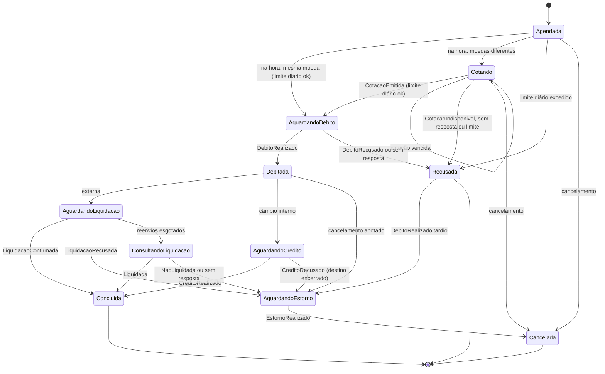
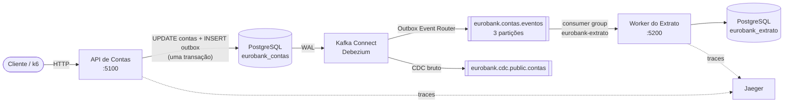
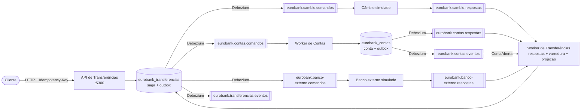

# EuroBank

Laboratório de estudo de **CDC (Change Data Capture)** com **Debezium**, **Kafka** e **.NET 10**, organizado em
DDD com Clean Architecture, e de **saga orquestrada** sobre essa mesma base. É um banco fictício com três
contextos que conversam apenas por mensagens, mais um banco externo simulado:

- **Contas**: abre contas em EUR, USD, GBP ou BRL, deposita, saca, transfere, bloqueia, desbloqueia e encerra.
  Grava no PostgreSQL.
- **Extrato**: consome os eventos de Contas pelo Kafka e monta o extrato de cada conta, na moeda dela.
- **Transferencias**: orquestra a transferência para um IBAN de outro banco (débito em Contas, liquidação no
  banco externo e, se a liquidação falhar, estorno do débito) e o câmbio entre contas EuroBank de moedas
  diferentes (cotação, débito, crédito), com prazos, reenvios e cancelamento.
- **Banco externo simulado**: um sistema "de fora" que liquida, recusa, atrasa ou some conforme o final do IBAN.
- **Câmbio simulado**: um provedor de cotações "de fora", com spread e cotação travada por 10 minutos.

Nenhuma API do EuroBank fala com o Kafka. Cada uma grava a alteração e a mensagem na tabela `outbox` do seu
banco, na mesma transação, e o Debezium lê essas mudanças no log de transações (WAL) do PostgreSQL e as publica
no Kafka. Tudo sobe com um único `docker compose up`.

## Por que este laboratório existe

O objetivo é aprender, com código que roda e pode ser quebrado de propósito, os problemas que aparecem quando
dois sistemas precisam ficar consistentes sem compartilhar uma transação:

1. **Entender o CDC baseado em log.** Ver o Debezium se conectar ao PostgreSQL como uma réplica, ler o WAL por
   um replication slot e transformar cada alteração confirmada em mensagem, sem triggers e sem consultas
   periódicas às tabelas.
2. **Resolver o dual write com o Outbox Pattern.** Gravar no banco e publicar no broker são duas operações em
   sistemas diferentes; sem cuidado, uma acontece e a outra não. A outbox torna as duas atômicas.
3. **Comparar outbox e CDC bruto lado a lado.** O mesmo depósito aparece como evento de negócio
   (`DepositoRealizado`) e como a linha da tabela com o estado anterior e o posterior.
4. **Consumir com segurança.** A entrega do Kafka é "pelo menos uma vez": duplicatas, reprocessamento, ordem
   por partição, mensagens inválidas e escala horizontal precisam ser tratados no consumidor.
5. **Observar o fluxo inteiro.** Um único trace no Jaeger atravessa a API, a outbox, o Debezium, o Kafka e o
   consumidor.
6. **Praticar DDD, Clean Architecture e TDD** num domínio com regras reais (saldo, estados da conta,
   concorrência) e com testes que usam a infraestrutura de verdade.
7. **Orquestrar uma saga com compensação.** A transferência para outro banco envolve três sistemas, cada um com
   o próprio banco de dados. O orquestrador é um agregado DDD com o estado no PostgreSQL; comandos e respostas
   passam pela mesma combinação de outbox, Debezium e Kafka. Respostas que não chegam, chegam atrasadas ou
   chegam duas vezes são o caso normal, não a exceção.

## O que foi construído

| Parte | O que faz |
|---|---|
| Domínio de Contas | Agregado `Conta` com estados (Ativa, Bloqueada, Encerrada), moeda escolhida na abertura, versão de negócio, value objects `Dinheiro` (valor e moeda; operar moedas diferentes é proibido), `Iban` (dígito verificador módulo 97) e `Titular`, serviço de domínio de transferência atômica entre contas da mesma moeda |
| API de Contas | Minimal API com Wolverine como mediator, erros de domínio em ProblemDetails (400, 404, 409, 422), Swagger, seed de contas de exemplo |
| Outbox | A unidade de trabalho grava conta e eventos na mesma transação, na ordem em que os eventos aconteceram |
| Debezium | Dois conectores: Outbox Event Router (eventos de negócio) e CDC bruto da tabela `contas` (before e after) |
| Extrato | Worker com Wolverine consumindo o Kafka: inbox durável, ordem por conta, retry, dead letter e a projeção do extrato com paginação, incluindo transferências externas com tarifa e estornos |
| Sagas de transferência | Agregado `Transferencia` com a máquina de estados da externa e do câmbio interno, cotação antes do débito quando as moedas diferem (com recotação), prazo por passo, até 3 reenvios, consulta de status antes de estornar, cancelamento pelo cliente, agendamento, tarifa e limite diário por moeda; histórico de cada passo |
| API de Transferências | `POST /transferencias-externas` e `POST /transferencias-cambio` com `Idempotency-Key`, consulta com histórico e cotação, listagem com filtros e cancelamento; o limite diário é conferido com um advisory lock por conta |
| Worker de Transferências | Respostas de Contas, do câmbio e do banco externo (inbox durável), a projeção local das contas (eventos `ContaAberta`) e uma varredura que começa as agendadas e trata os prazos com `FOR UPDATE SKIP LOCKED` |
| Worker de Contas | Executa os comandos da saga (debitar, creditar, estornar, liberar a trava) com idempotência pelo id da transferência e responde pela outbox; a trava semântica impede encerrar a conta no meio da saga |
| Simuladores | Banco externo e câmbio com Confluent.Kafka e Npgsql puros, sem Wolverine e sem EF: inbox escrita à mão e respostas agendadas no banco, compartilhadas pelos dois |
| Segurança | Uma API key por API (`X-Api-Key`), com `/health` e Swagger abertos |
| Infraestrutura | Docker Compose com PostgreSQL em replicação lógica, Kafka em modo KRaft, Kafka Connect, Kafbat UI e Jaeger, com os databases, os tópicos e os conectores criados automaticamente |
| Observabilidade | Serilog estruturado e OpenTelemetry, com o `traceparent` levado pela outbox até o consumidor e de volta nas respostas da saga |
| Testes | 366 testes: unitários, de integração com Testcontainers e ponta a ponta com Debezium real, incluindo cada caminho das sagas |
| Carga | Script k6 que gera operações em paralelo e confere se o Extrato convergiu para Contas |

## Como funciona

O caminho de um depósito:

1. A API recebe `POST /contas/{id}/depositos`. O agregado `Conta` valida as regras, atualiza o saldo,
   incrementa a versão e registra o evento de domínio `DepositoRealizado`.
2. A unidade de trabalho abre uma transação, faz o `UPDATE` em `contas` e o `INSERT` do evento na `outbox`, e
   confirma as duas coisas juntas.
3. O PostgreSQL escreve essas mudanças no WAL antes de confirmar o commit.
4. O Debezium lê o WAL pelos replication slots e publica:
   - pelo Outbox Event Router, o evento no tópico `eurobank.contas.eventos`, com o id da conta como chave e
     os headers `id`, `tipo` e `traceparent`;
   - pelo conector de CDC bruto, a linha alterada em `eurobank.cdc.public.contas`.
5. O worker do Extrato recebe a mensagem. O header `tipo` escolhe o manipulador, o header `id` é a chave de
   deduplicação da inbox e o `traceparent` continua o trace.
6. A projeção aplica o evento só se a versão for nova. Mensagens repetidas não alteram o saldo.

Dois padrões lado a lado:

| | Outbox | CDC bruto |
|---|---|---|
| Tabela capturada | `outbox` | `contas` |
| Tópico | `eurobank.contas.eventos` | `eurobank.cdc.public.contas` |
| Conteúdo | evento de negócio com contrato próprio | a linha da tabela: `before`, `after`, `op`, `source` |
| Chave | id da conta (ordem garantida por conta) | `{ "id": ... }` da linha |
| Headers | `id` (id do evento), `tipo`, `traceparent` | metadados do Debezium |
| Quem consome | o Extrato | ninguém: só inspeção na UI |

Em um sistema real, a integração entre serviços normalmente usa só a outbox. O CDC bruto serve para levar
dados a outros sistemas (data warehouse, índice de busca, cache). Aqui os dois existem para comparação.

### O caminho de uma transferência externa

1. A API de Transferências recebe `POST /transferencias-externas` com o header `Idempotency-Key`. O agregado
   `Transferencia` valida o pedido (IBAN de outro banco, BIC, valor), calcula a tarifa e, se for para já,
   confere o limite diário e pede o débito. Estado e comando `DebitarTransferenciaExterna` vão juntos para o
   banco: a saga e a outbox, na mesma transação.
2. O Debezium publica o comando em `eurobank.contas.comandos`, com o id da conta como chave. O worker de Contas
   debita valor e tarifa, guarda o id da transferência (idempotência e trava contra encerramento) e responde
   `DebitoRealizado` pela outbox de Contas, em `eurobank.contas.respostas`.
3. O worker de Transferências aplica a resposta e pede a liquidação ao banco externo
   (`eurobank.banco-externo.comandos`). O banco simulado responde em `eurobank.banco-externo.respostas`.
4. Com `LiquidacaoConfirmada`, a saga termina `Concluida` e manda `LiberarTravaTransferencia` a Contas. Com
   `LiquidacaoRecusada`, pede o estorno e termina `Cancelada` quando Contas confirmar a devolução.
5. Em paralelo, a varredura do worker acompanha os prazos. Sem resposta no prazo, o comando é reenviado (com id
   novo; os participantes deduplicam pelo id da transferência). Esgotados os reenvios da liquidação, a saga
   consulta o status no banco antes de decidir pelo estorno.



O banco externo simulado decide pelo final do IBAN de destino, para cada caminho poder ser reproduzido:

| Final | Comportamento | Fim da saga |
|---|---|---|
| `99` | recusa | `Cancelada` (`RecusadaPeloBanco`), com estorno |
| `98` | nunca responde, nem à consulta | `Cancelada` (`SemRespostaDoBanco`), depois dos reenvios e das consultas |
| `97` | responde em 45 s, depois do primeiro prazo | `Concluida`, com um reenvio e a resposta duplicada ignorada |
| `96` | liquida, mas a resposta se perde | `Concluida` pela consulta de status, sem estorno |
| outros | confirma em 1 s | `Concluida` |

Prazos padrão: cotação 30 s, débito 30 s, liquidação 30 s, consulta 15 s, crédito 30 s e estorno 30 s, com até 3
reenvios por passo. Crédito e estorno reenviam sem limite: desistir deles deixaria o dinheiro em dois lugares ou
em nenhum.

### Transferências com câmbio

As contas têm moeda (EUR, USD, GBP ou BRL), escolhida na abertura. Quando a moeda de destino é outra, a saga
começa cotando: manda `CotarCambio` ao câmbio simulado (`eurobank.cambio.comandos`) e só pede o débito quando
a cotação chega, porque só então se sabe quanto sai da conta. O limite diário é conferido nesse momento, com o
valor convertido.

- **Externa com câmbio**: `POST /transferencias-externas` com `moedaDestino` diferente da conta. O débito é na
  moeda da conta; a liquidação no banco externo, na moeda de destino.
- **Câmbio interno**: `POST /transferencias-cambio` para outra conta EuroBank de outra moeda. A saga debita a
  origem e credita o destino (estado `AguardandoCredito`); se o destino estiver encerrado, estorna a origem.
- O campo `valor` pode estar na moeda de origem ou na de destino (`moedaDoValor`): "mandar 100 EUR" ou "o destino
  recebe exatamente 100 USD".

O câmbio simulado usa base EUR (1 EUR = 1,08 USD = 0,86 GBP = 5,90 BRL), cruza os outros pares pelo euro,
aplica 1% de spread contra o cliente, trava a cotação por 10 minutos, arredonda meio para cima e não negocia o
par BRL e GBP. Exemplo: para o destino receber 100 USD, uma conta em euro paga 93,53 EUR à taxa de 1,0692, mais a
tarifa.

| Moeda da conta | Tarifa | Limite diário |
|---|---|---|
| EUR | 2,50 | 5.000 |
| USD | 2,70 | 5.400 |
| GBP | 2,20 | 4.300 |
| BRL | 15,00 | 30.000 |

Transferencias não consulta Contas: mantém uma **projeção local das contas** (id, IBAN, titular e moeda) a partir
dos eventos `ContaAberta` de `eurobank.contas.eventos`. Uma conta recém-aberta pode levar um instante para chegar
à projeção; até lá, o pedido recebe 422 (`conta_origem_desconhecida`) e pode ser repetido com a mesma
`Idempotency-Key`.

## O que o laboratório revelou

Problemas reais encontrados durante a construção, cada um com um teste que o reproduz:

1. **Eventos gravados antes de o replication slot existir nunca são publicados.** O seed criava as contas de
   exemplo antes de os conectores serem registrados e, sem snapshot, esses eventos se perdiam. Solução:
   registrar os conectores antes de a aplicação gravar qualquer dado.
2. **O EF Core reordena os INSERTs de um mesmo SaveChanges.** O Debezium publica na ordem do WAL, então um
   depósito chegou ao Kafka antes da abertura da própria conta. Solução: a unidade de trabalho insere as linhas
   da outbox uma a uma, na ordem dos eventos, e a tabela ganhou a coluna `sequencia` com a ordem física de
   inserção.
3. **Duplicatas exigem mais de uma defesa.** A inbox durável do Wolverine descarta mensagens repetidas pelo id
   durante 7 dias. Depois disso, ou se a inbox for apagada, a regra de versão do extrato descarta o evento. Um
   índice único por conta e versão é a última barreira no banco. No reprocessamento completo do tópico com a
   inbox apagada, 8.818 mensagens foram descartadas e nenhum saldo mudou.
4. **Retry não conserta mensagem inválida.** Falhas transitórias (banco fora, timeout) têm novas tentativas;
   mensagens sem o header `tipo` ou com corpo inválido vão direto para o dead letter, e o consumo continua.
5. **Ordem e paralelismo convivem por chave.** Eventos da mesma conta são processados em ordem, contas
   diferentes em paralelo, e com 3 instâncias do Extrato cada uma assume uma partição.
6. **Observabilidade também precisa de filtro.** As consultas periódicas do Wolverine ao banco geravam traces
   avulsos que escondiam os traces das operações. Um amostrador descarta chamadas que não pertencem a nenhuma
   requisição ou mensagem.
7. **O orquestrador não sabe se o débito aconteceu.** Se Contas não responde, o comando continua no Kafka e
   pode ser executado depois que a saga desistiu. Solução: a saga termina `Recusada` (`SemRespostaDeContas`),
   guarda que o débito ficou sem resposta e, se o `DebitoRealizado` chegar mais tarde, pede o estorno.
8. **A varredura e as respostas disputam a mesma saga.** Uma resposta e um prazo vencido chegaram juntos na
   mesma transferência. A versão otimista e a chave do histórico (transferência e ordem do passo) fazem um dos
   dois falhar; o Wolverine tenta de novo com a saga recarregada e a resposta é aplicada no estado novo.
9. **Limite diário precisa de serialização por conta.** Seis pedidos simultâneos de 1.000 EUR na mesma conta
   passariam todos pela soma do dia. Um advisory lock do PostgreSQL por conta, até o commit, faz exatamente
   cinco passarem.
10. **Scripts de init do PostgreSQL só rodam num volume novo.** Num laboratório que já existia, o database
    novo não seria criado e o conector do Debezium falharia. Solução: um serviço que cria os databases que
    faltam a cada subida, antes do registro dos conectores.
11. **O reenvio por prazo também cobre a perda de mensagens.** Durante um teste, o Docker reiniciou e o Kafka
    (sem volume no laboratório) perdeu os comandos que ainda estavam nos tópicos. As sagas estavam salvas no
    PostgreSQL: quando os prazos venceram, a varredura reenviou os comandos e todas terminaram `Concluida`.
12. **No câmbio interno, o mesmo id de transferência aparece em duas contas.** A tabela que guarda as
    transferências de cada conta (trava e idempotência) tinha o id da transferência como chave; o crédito no
    destino colidiu com o débito na origem. A chave passou a ser conta e transferência.
13. **Uma projeção só conhece o que viu.** Transferencias aprende as contas pelos eventos `ContaAberta`; contas
    abertas antes de o worker existir, e cujos eventos já saíram da retenção do Kafka, não aparecem. Num
    laboratório novo isso não acontece; em produção, a resposta é retenção longa ou compactação do tópico, ou um
    snapshot inicial da projeção.
14. **Um conversor do EF não enxerga outra coluna.** Com o `Dinheiro` levando a moeda, o saldo não podia mais
    ser convertido sozinho de `numeric` para `Dinheiro`. Os agregados guardam o número num campo privado e
    montam o `Dinheiro` com a moeda da conta.

## Arquitetura

CDC de Contas para o Extrato:



Saga de transferência externa (cada seta para o Kafka sai de uma outbox, lida pelo Debezium, exceto a do banco
externo, que publica direto por ser um sistema de fora):



## Tecnologias

| Peça | Versão |
|---|---|
| .NET | 10 |
| PostgreSQL | 18.6 |
| Apache Kafka (KRaft) | 4.4.0 |
| Debezium (Kafka Connect) | 3.6.3.Final |
| Wolverine | 6.60 |
| Entity Framework Core e Npgsql | 10 |
| Confluent.Kafka (banco externo simulado) | 2.16 |
| Kafbat UI | 1.5.0 |
| Jaeger | 2.22 |
| k6 | 2.3 |
| xUnit v3, Shouldly, Testcontainers | 4.0, 4.3, 4.16 |

## Pré-requisitos

- Docker com Docker Compose (o compose completo usa cerca de 7 GB de RAM)
- .NET SDK 10.0.400 ou mais recente (para rodar testes ou depurar pela IDE)

## Como subir

```bash
docker compose up -d --build
```

A ordem de subida é controlada pelo compose: Postgres e Kafka, criação dos databases e dos tópicos com 3
partições, Kafka Connect, registro dos conectores, APIs de Contas (aplica as migrations e cria as contas de
exemplo Ana, Bruno e Carla) e de Transferências (aplica as migrations), e depois os workers e os simuladores.

| Serviço | URL |
|---|---|
| API de Contas (Swagger) | http://localhost:5100/swagger |
| Extrato (Swagger) | http://localhost:5200/swagger |
| API de Transferências (Swagger) | http://localhost:5300/swagger |
| Kafbat UI (tópicos, mensagens, consumer groups, conectores) | http://localhost:8080 |
| Kafka Connect (REST) | http://localhost:8083/connectors |
| Jaeger (traces) | http://localhost:16686 |
| PostgreSQL | `localhost:5434`, usuário e senha `eurobank` (porta configurável em `.env`) |
| Kafka (para apps no host) | `localhost:9092` |

As credenciais existem só para o ambiente local do laboratório.

As rotas de negócio exigem o header `X-Api-Key`, com uma chave por API, definidas no `.env`
(`CONTAS_API_KEY`, `EXTRATO_API_KEY`, `TRANSFERENCIAS_API_KEY`). Sem a chave, a resposta é 401. O `/health` e o
Swagger ficam abertos; no Swagger, use o botão Authorize. Os roteiros `.http` e o k6 já enviam as chaves de
laboratório.

Roteiros de requisições prontos: [`http/contas.http`](http/contas.http), [`http/extrato.http`](http/extrato.http)
e [`http/transferencias.http`](http/transferencias.http).

Para recomeçar do zero (apaga os dados do laboratório): `docker compose down -v`.

## Estrutura

```
src/
  Shared/   EuroBank.Shared (blocos de domínio, Dinheiro e Moeda, Paginacao)
            EuroBank.Shared.Persistence (outbox genérica com escrita ordenada)
            EuroBank.Shared.Messaging (mapeador do Debezium e convenções do Wolverine)
            EuroBank.Shared.Web (Serilog, OpenTelemetry, erros em ProblemDetails, API key)
  Contas/   Domain | Application | Infrastructure | Api | Worker (comandos das sagas)
  Extrato/  Domain | Application | Infrastructure | Worker
  Transferencias/  Domain | Application | Infrastructure | Api | Worker (orquestrador das sagas)
  Simuladores/  Comum | BancoExterno | Cambio (sistemas de fora: Confluent.Kafka e Npgsql puros, sem Wolverine e sem EF)
tests/      testes unitários, de integração (Testcontainers) e ponta a ponta (Debezium de verdade)
infra/      criação dos databases e dos tópicos, conectores do Debezium, script do k6
http/       roteiros de requisições
```

Convenções: nomes de projetos e pastas técnicas em inglês (`Entities`, `ValueObjects`, `Events`, `Exceptions`,
`TransferObjects`, `Replies`...), classes de negócio e métodos em português, uma classe por arquivo. Os
contextos não referenciam uns aos outros: cada um tem os próprios DTOs para as mensagens que consome.

Pontos do código que valem a leitura:

- `src/Contas/EuroBank.Contas.Domain/Entities/Conta.cs`: o agregado decide qual evento acontece.
- `src/Shared/EuroBank.Shared.Persistence/Outbox/UnidadeDeTrabalhoComOutbox.cs`: estado e outbox na mesma
  transação, com as linhas inseridas na ordem dos eventos.
- `infra/connect/conectores/eurobank-contas-outbox.json`: como cada coluna da outbox vira tópico, chave, header
  ou corpo da mensagem.
- `src/Shared/EuroBank.Shared.Messaging/MapeadorEnvelopeDebezium.cs`: como o Wolverine lê os
  headers do Debezium.
- `src/Shared/EuroBank.Shared.Messaging/WolverineExtensions.cs`: inbox durável, ordem por
  conta, retry e dead letter.
- `src/Extrato/EuroBank.Extrato.Domain/Entities/ExtratoConta.cs`: a regra de versão que torna a projeção
  idempotente.
- `src/Transferencias/EuroBank.Transferencias.Domain/Entities/Transferencia.cs`: a saga como agregado; cada
  resposta e cada prazo vencido decide o próximo comando, e o que não cabe no estado atual é ignorado e anotado
  no histórico.
- `src/Transferencias/EuroBank.Transferencias.Infrastructure/Persistence/Repositories/RepositorioTransferencias.cs`:
  o advisory lock do limite diário e o `FOR UPDATE SKIP LOCKED` da varredura.
- `src/Simuladores/EuroBank.Simuladores.Comum/RepositorioSimulador.cs` e
  `src/Simuladores/EuroBank.Simuladores.BancoExterno/ProcessadorComandos.cs`: inbox e agenda de respostas
  escritas à mão, para comparar com o que o Wolverine faz nos outros serviços.
- `src/Simuladores/EuroBank.Simuladores.Cambio/Regras/TabelaCambio.cs`: taxas cruzadas pelo euro, spread e
  arredondamento meio para cima.

## Depurar pela IDE

A infra continua no Docker; só as aplicações rodam no host.

```bash
docker compose stop contas-api extrato-worker transferencias-api transferencias-worker
dotnet run --project src/Contas/EuroBank.Contas.Api
dotnet run --project src/Extrato/EuroBank.Extrato.Worker
dotnet run --project src/Transferencias/EuroBank.Transferencias.Api
dotnet run --project src/Transferencias/EuroBank.Transferencias.Worker
```

Os `appsettings.json` já apontam para `localhost:5434` (Postgres) e `localhost:9092` (Kafka), e as portas
continuam 5100, 5200 e 5300 (os workers de Contas e de Transferências ficam em 5101 e 5301, o banco externo
simulado em 5401 e o câmbio simulado em 5402).

## Testes

```bash
dotnet test
```

Precisa do Docker rodando: os testes de integração e ponta a ponta sobem os próprios containers com
Testcontainers. Os testes ponta a ponta usam os mesmos conectores de `infra/connect/conectores` e cobrem o
evento nos dois tópicos, a convergência do extrato, o trace contínuo, o Kafka Connect parado e religado sem
perda, a duplicata barrada pela inbox e as mensagens inválidas no dead letter. Para a saga, com prazos curtos,
cobrem cada final de IBAN do banco externo, as recusas (saldo, conta bloqueada ou encerrada, limite diário), o
agendamento, os dois tipos de cancelamento, a `Idempotency-Key` e a trava que impede encerrar a conta. Para o
câmbio: a externa em outra moeda com o extrato mostrando a cotação, o par indisponível, o câmbio entre contas
EuroBank (concluído e com o destino encerrado) e a transferência síncrona entre moedas recusada.

## Roteiro de exercícios

### 1. Seguir uma operação até o extrato

Faça um depósito pelo `http/contas.http`. No Kafbat UI, abra os dois tópicos e compare: em
`eurobank.contas.eventos`, o evento `DepositoRealizado` com os headers `id`, `tipo` e `traceparent`; em
`eurobank.cdc.public.contas`, a linha da conta com o saldo antes e depois. Depois consulte o extrato pelo
`http/extrato.http`.

### 2. Kafka Connect fora do ar

```bash
docker compose stop connect
# faça algumas operações pelo contas.http
docker compose exec postgres psql -U eurobank -d eurobank_contas -c "SELECT slot_name, active, confirmed_flush_lsn, pg_current_wal_lsn() FROM pg_replication_slots;"
docker compose start connect
```

Com o Connect parado, o `confirmed_flush_lsn` dos slots não avança e o WAL fica retido. Ao religar, o Debezium
retoma do ponto salvo e todos os eventos chegam ao Extrato.

### 3. Reprocessar o tópico (duas camadas de idempotência)

```bash
docker compose stop extrato-worker
docker compose exec kafka /opt/kafka/bin/kafka-consumer-groups.sh --bootstrap-server kafka:29092 \
  --group eurobank-extrato --topic eurobank.contas.eventos --reset-offsets --to-earliest --execute
docker compose start extrato-worker
```

Os saldos não mudam: a inbox durável do Wolverine ainda lembra os ids das mensagens (retenção de 7 dias) e as
descarta. Para ver a segunda camada, repita apagando também a memória da inbox antes de religar o worker:

```bash
docker compose exec postgres psql -U eurobank -d eurobank_extrato -c "DELETE FROM wolverine.wolverine_incoming_envelopes;"
```

Agora as mensagens chegam aos manipuladores, e o log do worker mostra
`ignorado: a versão N já foi aplicada`. A regra de versão do `ExtratoConta` impede que o saldo mude.

### 4. Dead letter

No Kafbat UI, produza uma mensagem em `eurobank.contas.eventos` sem o header `tipo`, ou com `tipo` igual a
`DepositoRealizado` e um corpo que não seja JSON. Ela vai direto para o dead letter (tentar de novo não
resolveria), e o consumo das mensagens seguintes continua:

```bash
docker compose exec postgres psql -U eurobank -d eurobank_extrato -c "SELECT id, message_type, exception_type, exception_message FROM wolverine.wolverine_dead_letters;"
```

Mensagens com um `tipo` desconhecido não são erro: são ignoradas com um alerta no log (tolerant reader).

### 5. Escalar o Extrato para 3 instâncias

```bash
docker compose -f docker-compose.yml -f docker-compose.escala.yml up -d --scale extrato-worker=3
docker compose exec kafka /opt/kafka/bin/kafka-consumer-groups.sh --bootstrap-server kafka:29092 \
  --describe --group eurobank-extrato
```

Cada instância fica com uma das 3 partições. Como a chave da mensagem é o id da conta, os eventos de uma conta
sempre caem na mesma partição e continuam em ordem. Para voltar a uma instância: `docker compose up -d`.

### 6. Carga com k6

```bash
docker compose --profile carga run --rm k6
docker compose --profile carga run --rm -e VUS=20 -e DURACAO=2m k6
```

O script abre contas, dispara depósitos, saques e transferências em paralelo e, no fim, confere conta a conta se
o Extrato convergiu para o saldo e a versão de Contas. Numa máquina de desenvolvimento, 10 usuários virtuais
fazem cerca de 160 operações por segundo sem erros.

### 7. Trace ponta a ponta

No Jaeger, escolha o serviço `eurobank-contas` e abra o trace de um `POST`. O mesmo trace contém o processamento
no `eurobank-extrato`: o `traceparent` gravado na outbox atravessa o Debezium e o Kafka como header.

### 8. Outbox que se apaga sozinha

```bash
OUTBOX_APAGAR_APOS_GRAVAR=true docker compose up -d contas-api
```

(No PowerShell: `$env:OUTBOX_APAGAR_APOS_GRAVAR="true"; docker compose up -d contas-api`.)

Agora cada linha da outbox é inserida e apagada na mesma transação. A tabela fica vazia, mas os eventos
continuam chegando ao Kafka: o Debezium lê o INSERT no WAL, não a tabela.

### 9. Um caminho da saga por final de IBAN

Pelo `http/transferencias.http`, peça transferências para IBANs terminados em `00`, `99`, `98`, `97` e `96` (uma
`Idempotency-Key` diferente em cada pedido) e acompanhe cada uma pelo `GET /transferencias/{id}`: o histórico
mostra cada comando enviado, cada reenvio, cada resposta recebida e as respostas ignoradas. No Kafbat UI, siga
os comandos e as respostas pelos tópicos `eurobank.contas.*` e `eurobank.banco-externo.*`. Os finais `98` e `96`
levam cerca de 2 minutos com os prazos padrão; para encurtar:

```bash
SAGA_PRAZO_LIQUIDACAO=00:00:05 SAGA_PRAZO_CONSULTA=00:00:03 docker compose up -d transferencias-api transferencias-worker
```

### 10. Contas fora do ar no meio da saga

```bash
docker compose stop contas-worker
# peça uma transferência pelo transferencias.http e acompanhe o histórico
docker compose start contas-worker
```

Sem resposta, a saga reenvia o débito três vezes e termina `Recusada` (`SemRespostaDeContas`). Os comandos
continuam no Kafka: quando o worker de Contas volta, ele debita uma vez só (os reenvios têm o mesmo id de
transferência) e responde. A saga recebe o `DebitoRealizado` tardio, pede o estorno e termina `Cancelada`, com o
saldo de volta.

### 11. Duas instâncias do orquestrador

```bash
docker compose up -d --scale transferencias-worker=2
docker compose logs -f transferencias-worker
```

As duas instâncias dividem as partições dos tópicos de resposta e rodam a varredura ao mesmo tempo. O
`FOR UPDATE SKIP LOCKED` faz cada transferência vencida ser tratada por uma instância só. Para voltar a uma:
`docker compose up -d --scale transferencias-worker=1`.

### 12. Câmbio: para fora e entre contas

Pelo `http/contas.http`, abra uma conta em USD; pelo `http/transferencias.http`, mande 100 USD de uma conta em
euro para um IBAN externo (`moedaDestino` e `moedaDoValor` iguais a `USD`) e para a conta em dólar
(`POST /transferencias-cambio`). No `GET /transferencias/{id}`, veja a cotação travada, o valor debitado em euro
e o valor de destino em dólar; no Kafbat UI, o `CotarCambio` em `eurobank.cambio.comandos` e a resposta em
`eurobank.cambio.respostas`. Os extratos das duas contas mostram os dois lados, cada um na sua moeda. Para ver a
recusa por câmbio, abra uma conta em BRL e mande para fora com `moedaDestino` igual a `GBP`.

## Laboratório e produção

Atalhos que este laboratório toma de propósito:

| No laboratório | Em produção |
|---|---|
| Publications `FOR ALL TABLES`, para registrar os conectores antes de as tabelas existirem | Publication criada por migration ou pelo DBA, só com as tabelas capturadas |
| Debezium conecta com o usuário dono do banco | Usuário dedicado com permissão `REPLICATION` e leitura só nas tabelas capturadas |
| Kafka com um nó, sem volume, fator de replicação 1 | Cluster com fator de replicação 3 e dados persistentes |
| JSON sem schema | Muitas vezes Avro ou Protobuf com Schema Registry, para versionar contratos |
| Sem monitoramento dos replication slots | Alerta de atraso de slot (um slot parado enche o disco com WAL) e heartbeat configurado |
| CDC bruto e outbox no mesmo banco, para comparar | Integração entre serviços pela outbox; CDC bruto só para levar dados a outros sistemas |
| Uma API key fixa por API, guardada no `.env` | OAuth 2.0 ou OpenID Connect com tokens de curta duração e segredos em cofre |
| Banco externo simulado, com o comportamento escolhido pelo final do IBAN | Integração com a rede de pagamentos (SEPA, mensagens ISO 20022), com contrato e homologação |
| Prazo fixo por passo e até 3 reenvios | Espera crescente com variação aleatória e alerta para sagas paradas num estado |
| Orquestrador próprio, com varredura a cada 2 s | Igual, ou um motor de workflow (Temporal, Camunda) quando os processos são muitos e longos |
| Câmbio simulado com taxas fixas e spread único | Provedor de cotações real, com taxas que mudam a cada segundo e spread por cliente e por valor |
| Projeção local de contas montada só pelos eventos que o worker viu | Tópico com retenção longa ou compactado, ou um snapshot inicial da projeção antes de consumir |

## Próximos passos

Prontas: a **saga orquestrada** de transferência externa (prazos, reenvios, consulta antes de estornar,
cancelamento, agendamento, tarifa, limite diário e `Idempotency-Key`) e o **câmbio** (contas em quatro moedas,
cotação travada com spread, externa em outra moeda e câmbio entre contas EuroBank). As próximas:

1. Validações SEPA e SWIFT com horário de corte, devolução pelo banco externo, estado `Divergente` com
   reconciliação e saldo negativo controlado.
2. Notificações por e-mail (Mailpit), cenário de carga das sagas no k6 e diagramas de sequência.

Depois disso, um contexto de **antifraude** com regras e machine learning (ML.NET), comunicação gRPC entre os
serviços e Redis.
