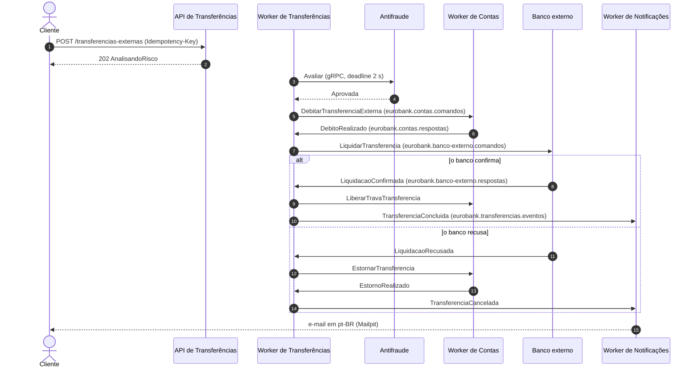
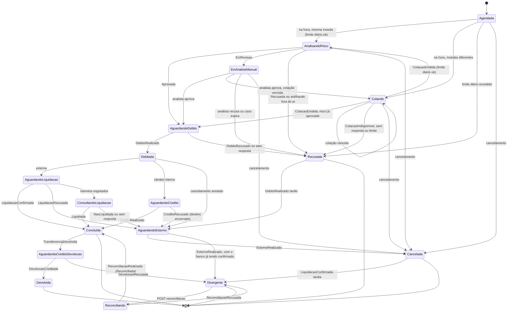
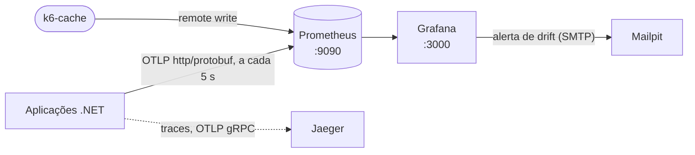
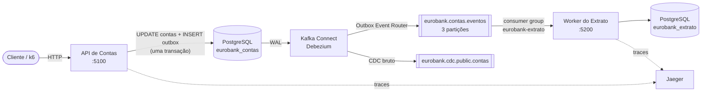
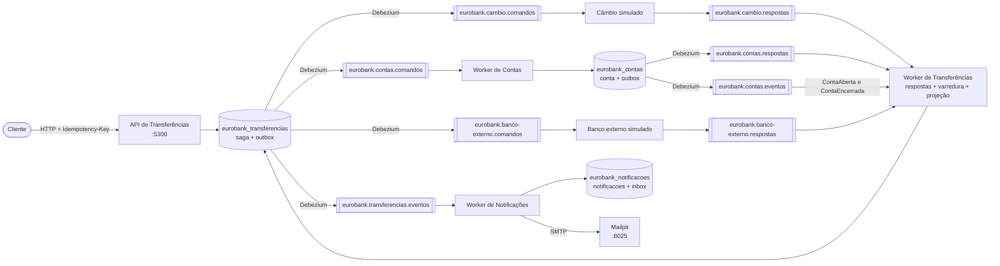
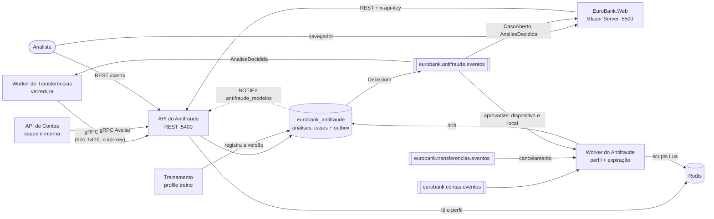

# EuroBank

Laboratório de estudo de **CDC (Change Data Capture)** com **Debezium**, **Kafka** e **.NET 10**, organizado em
DDD com Clean Architecture, de **saga orquestrada** sobre essa mesma base e de **antifraude** com gRPC e Redis no
meio da saga. É um banco fictício com cinco contextos que conversam por mensagens (e, da saga para o antifraude, por
gRPC), mais dois sistemas "de fora" simulados:

- **Contas**: abre contas em EUR, USD, GBP ou BRL, deposita, saca, transfere, bloqueia, desbloqueia e encerra.
  Grava no PostgreSQL. Antes do saque e da transferência interna, pergunta ao antifraude.
- **Extrato**: consome os eventos de Contas pelo Kafka e monta o extrato de cada conta, na moeda dela, com o resumo
  e a primeira página no Redis (cache-aside, write-through ou write-behind, à escolha).
- **Transferencias**: orquestra a transferência para um IBAN de outro banco (débito em Contas, liquidação no
  banco externo e, se a liquidação falhar, estorno do débito) e o câmbio entre contas EuroBank de moedas
  diferentes (cotação, débito, crédito), com prazos, reenvios, cancelamento, regras SEPA com horário de corte,
  devolução pelo banco e reconciliação quando o dinheiro não fecha. Antes de cada débito, pergunta ao antifraude.
- **Antifraude**: analisa o risco de cada transferência e de cada saque com regras duras e com peso (inclusive o
  dispositivo novo, o país fora do habitual e a viagem impossível), sobre um perfil de comportamento de cada conta
  mantido no Redis, e com o score de um modelo de machine learning (ML.NET) treinado em
  dados sintéticos, com challenger em sombra e drift medido contra o treino; aprova, recusa ou manda para a fila de
  um analista humano. Atende a saga por gRPC e o analista por REST e pelo painel do analista no `EuroBank.Web`, com
  a fila de casos em tempo real.
- **Banco externo simulado**: um sistema "de fora" que liquida, recusa, atrasa, some, confirma tarde demais ou
  devolve, conforme o final do IBAN.
- **Câmbio simulado**: um provedor de cotações "de fora", com spread e cotação travada por 10 minutos.
- **Web**: o `EuroBank.Web` (Blazor Server), o projeto de todas as funcionalidades web do laboratório: o início,
  com os números do antifraude e as ferramentas, e o painel do analista; as próximas áreas entram nele.
- **Notificacoes**: quando uma transferência termina, manda um e-mail em pt-BR para quem pediu (no Mailpit, uma
  caixa de e-mail de laboratório).

Nenhuma API do EuroBank fala com o Kafka. Cada uma grava a alteração e a mensagem na tabela `outbox` do seu
banco, na mesma transação, e o Debezium lê essas mudanças no log de transações (WAL) do PostgreSQL e as publica
no Kafka. As únicas chamadas síncronas entre contextos vão ao antifraude, por gRPC: a do worker de Transferências,
antes do débito da saga, e a da API de Contas, antes do saque e da transferência interna. Tudo sobe com um único
`docker compose up`; profiles opcionais ligam o Redis em alta disponibilidade (Sentinel) e as métricas (Prometheus e
Grafana, com dashboards e alerta prontos).

## Por que este laboratório existe

O objetivo é aprender, com código que roda e pode ser quebrado de propósito, os problemas que aparecem quando
dois sistemas precisam ficar consistentes sem compartilhar uma transação:

1. **Entender o CDC baseado em log.** Ver o Debezium se conectar ao PostgreSQL como uma réplica, ler o WAL por
   um replication slot e transformar cada alteração confirmada em mensagem, sem triggers e sem consultas
   periódicas às tabelas.
2. **Resolver o dual write com o Outbox Pattern.** Gravar no banco e publicar no broker são duas operações em
   sistemas diferentes; sem cuidado, uma acontece e a outra não. A outbox torna as duas atômicas.
3. **Comparar outbox e CDC bruto lado a lado.** O mesmo depósito aparece como evento de negócio
   (`DepositoRealizado`) e como a linha da tabela com o estado anterior e o posterior.
4. **Consumir com segurança.** A entrega do Kafka é "pelo menos uma vez": duplicatas, reprocessamento, ordem
   por partição, mensagens inválidas e escala horizontal precisam ser tratados no consumidor.
5. **Observar o fluxo inteiro.** Um único trace no Jaeger atravessa a API, a outbox, o Debezium, o Kafka e o
   consumidor.
6. **Praticar DDD, Clean Architecture e TDD** num domínio com regras reais (saldo, estados da conta,
   concorrência) e com testes que usam a infraestrutura de verdade.
7. **Orquestrar uma saga com compensação.** A transferência para outro banco envolve três sistemas, cada um com
   o próprio banco de dados. O orquestrador é um agregado DDD com o estado no PostgreSQL; comandos e respostas
   passam pela mesma combinação de outbox, Debezium e Kafka. Respostas que não chegam, chegam atrasadas ou
   chegam duas vezes são o caso normal, não a exceção.
8. **Pôr uma decisão síncrona dentro de um fluxo assíncrono.** A saga pergunta ao antifraude por gRPC, com
   deadline, retry ou hedging e fail-closed quando ele cai; a resposta pode ser "espere um analista", e essa espera
   de até 30 minutos não segura nada além do limite diário.
9. **Usar o Redis sabendo o que acontece quando ele cai.** O mesmo Redis serve o perfil do antifraude, o cache do
   extrato em três estratégias, a Idempotency-Key, as cotações e o rate limit; cada uso tem um caminho para o Redis
   fora do ar (ler do Postgres, deixar passar ou recusar) e um teste que o percorre.
10. **Pôr um modelo de machine learning em produção com ciclo de vida.** As mesmas features no treino e na
    produção, dados sintéticos reproduzíveis, avaliação que faz sentido com fraude rara (AUC-PR, separação temporal),
    registro de versões, promoção sem reiniciar, challenger em sombra, explicação de cada decisão e drift medido
    contra o treino.
11. **Levar um evento do Kafka até a tela de uma pessoa.** O painel do analista é Blazor Server: o caso novo sai da
    outbox do antifraude, passa pelo Debezium e pelo Kafka e chega à fila aberta no navegador pelo circuito, sem
    ninguém recarregar a página.

## O que foi construído

| Parte | O que faz |
|---|---|
| Domínio de Contas | Agregado `Conta` com estados (Ativa, Bloqueada, Encerrada), moeda escolhida na abertura, versão de negócio, value objects `Dinheiro` (valor e moeda; operar moedas diferentes é proibido), `Saldo` (pode ficar negativo, mas só por reconciliação), `Iban` (dígito verificador módulo 97) e `Titular`, serviço de domínio de transferência atômica entre contas da mesma moeda |
| API de Contas | Minimal API com Wolverine como mediator, erros de domínio em ProblemDetails (400, 404, 409, 422) e requisição ilegível em 400, Swagger, seed de contas de exemplo; saque e transferência interna passam pelo antifraude em gRPC antes de mexer no saldo (422 `antifraude_revisao` ou `antifraude_indisponivel`), com a origem do cliente nos headers `X-Dispositivo-Id` e `X-Localizacao` |
| Outbox | A unidade de trabalho grava conta e eventos na mesma transação, na ordem em que os eventos aconteceram |
| Debezium | Dois conectores: Outbox Event Router (eventos de negócio) e CDC bruto da tabela `contas` (before e after) |
| Extrato | Worker com Wolverine consumindo o Kafka: inbox durável, ordem por conta, retry, dead letter e a projeção do extrato com paginação, incluindo transferências externas com tarifa, estornos, devoluções e reconciliações (com saldo negativo); resumo e primeira página no Redis conforme `Cache:Estrategia` (`Nenhuma`, `CacheAside`, `WriteThrough`, o padrão, ou `WriteBehind`), com o cache marcado como suspeito quando uma escrita no Redis falha e métricas de acerto, falta, duração e idade do dado |
| Sagas de transferência | Agregado `Transferencia` com a máquina de estados da externa e do câmbio interno, cotação antes do débito quando as moedas diferem (com recotação), análise de risco logo antes do débito (`AnalisandoRisco` e `EmAnaliseManual`, com recotação se a cotação vencer na revisão), prazo por passo, até 3 reenvios, consulta de status antes de estornar, cancelamento pelo cliente, agendamento, tarifa e limite diário por moeda, validação SEPA e SWIFT com horário de corte, estado `Divergente` com reconciliação e devolução pelo banco externo; histórico de cada passo |
| API de Transferências | `POST /transferencias-externas` e `POST /transferencias-cambio` com `Idempotency-Key` (reservada no Redis antes da constraint única do Postgres), consulta com histórico e cotação, listagem com filtros, cancelamento e `POST /transferencias-externas/{id}/reconciliacao`; o limite diário é conferido com um advisory lock por conta |
| Worker de Transferências | Respostas de Contas, do câmbio e do banco externo e decisões do antifraude (inbox durável), a projeção local das contas (eventos `ContaAberta` e `ContaEncerrada`) e uma varredura que começa as agendadas, chama o antifraude pelo gRPC (deadline de 2 s, retry ou hedging no canal) e trata os prazos com `FOR UPDATE SKIP LOCKED` |
| Worker de Contas | Executa os comandos da saga (debitar, creditar, estornar, liberar a trava, debitar a reconciliação, creditar a devolução) com idempotência pelo id da transferência e responde pela outbox; a trava semântica impede encerrar a conta no meio da saga |
| Domínio do Antifraude | Agregados `Analise` (uma por operação) e `CasoRevisao` (aberto, em análise, aprovado, recusado, expirado ou cancelado pelo cliente, com justificativa obrigatória e auditoria), 12 regras configuráveis (duas duras e dez com peso, com modo sombra; três delas pela origem da operação: dispositivo novo, país diferente do habitual e viagem impossível), configuração de decisão versionada (limiares 30 e 70, peso do modelo 50) e o motor que soma os pontos das regras e, com uma versão ativa, a probabilidade do modelo vezes o peso; versões do modelo (Registrada, Challenger, Ativa, Aposentada) e medições de drift por PSI |
| API do Antifraude | `AntifraudeService` em gRPC (`Avaliar` idempotente, com o dispositivo e a localização opcionais, `ObterAnalise`, `Simular`) com API key por interceptor, erros de domínio em status gRPC, reflection, `grpc.health.v1` e JSON transcoding; REST do analista (fila, detalhe, atribuição e decisão de casos, regras, limiares, listas de bloqueio e de países de risco, fraudes confirmadas, visão geral das últimas 24 h com o drift do modelo ativo); registro de modelos (versões, métricas, curva por limiar, ativação, challenger) com a troca em todas as instâncias sem reiniciar, por `LISTEN/NOTIFY` do Postgres |
| Worker do Antifraude | Perfil de comportamento de cada conta no Redis (saídas de 31 dias, entradas, beneficiários, saldo e idade da conta, atualizados por scripts Lua a partir de `eurobank.contas.eventos`, e os dispositivos e as localizações das operações aprovadas, a partir de `eurobank.antifraude.eventos`), expiração dos casos sem decisão, fechamento do caso quando o cliente cancela a transferência (`eurobank.transferencias.eventos`) e a medição do drift do modelo ativo a cada 5 minutos |
| EuroBank.Web | Blazor Server com MudBlazor (5500), o projeto das funcionalidades web, uma área por assunto: o início (os números do antifraude ao vivo e os links das ferramentas do laboratório) e, em `/antifraude`, o painel do analista: visão geral, fila de casos em tempo real, caso com sinais, features, explicação do modelo e do challenger, assumir e decidir, fraude confirmada, regras e limiares, listas, modelos (métricas, curva, champion e challenger, promoção) e simulador; chama a REST do antifraude pelo servidor (a API key não vai ao navegador) e ouve `eurobank.antifraude.eventos` num consumer group por instância |
| Machine learning | `Antifraude.Features` (11 features com o mesmo cálculo no treino e na produção, com teste de paridade), gerador de 99 mil transferências sintéticas com quatro padrões de fraude, treino com FastTree (peso por classe, separação temporal), avaliação com AUC-PR, precisão, recall, F1, matriz e curva por limiar e limiar recomendado por meta, rótulos dos analistas e das fraudes confirmadas, inferência com pool de `PredictionEngine` e explicação pela contribuição de cada feature |
| Simuladores | Banco externo e câmbio com Confluent.Kafka e Npgsql puros, sem Wolverine e sem EF: inbox escrita à mão e respostas agendadas no banco, compartilhadas pelos dois; o câmbio guarda a cotação válida no Redis e a reaproveita nos reenvios |
| Notificações | Worker com Wolverine consumindo `eurobank.transferencias.eventos`: e-mail em pt-BR (HTML e texto, pelo MailKit) para o Mailpit, inbox durável mais a tabela `notificacoes` com o id do evento como chave (reprocessar o tópico não repete e-mail), novas tentativas agendadas quando o SMTP falha e dead letter depois delas |
| Segurança | Uma API key por API (`X-Api-Key`; no gRPC, o metadata `x-api-key`), com `/health`, Swagger, reflection e `grpc.health.v1` abertos, e rate limit por API key nas rotas REST das quatro APIs (janela deslizante no Redis, 429 com `Retry-After`) |
| Infraestrutura | Docker Compose com PostgreSQL em replicação lógica, Kafka em modo KRaft, Kafka Connect, Kafbat UI, Jaeger, Mailpit, Redis e RedisInsight, com os databases, os tópicos e os conectores criados automaticamente; profiles `treino` (treino do modelo), `ha` (duas réplicas do Redis e três sentinels), `metricas` (Prometheus e Grafana) e `carga` (k6) |
| Observabilidade | Serilog estruturado e OpenTelemetry, com o `traceparent` levado pela outbox até o consumidor e de volta nas respostas da saga; métricas do ASP.NET Core e dos medidores do EuroBank (cache do extrato, modelo e drift) por OTLP no Prometheus, três dashboards no Grafana e o alerta de drift por e-mail |
| Testes | 958 testes: unitários, de integração com Testcontainers e ponta a ponta com Debezium real, incluindo cada caminho das sagas, os e-mails no Mailpit, as decisões do antifraude no meio da saga e em Contas, cada uso do Redis com ele ligado e fora do ar, o treino de um modelo de verdade, promovido e trocado sem reiniciar, as telas do painel com bUnit e os Dockerfiles e o compose conferidos contra os projetos |
| Carga | Script k6 que mistura operações de Contas com sagas externas e de câmbio e, no fim, confere que todas as sagas terminaram, que o Extrato convergiu e que nenhum dinheiro sumiu, moeda a moeda; respeita o 429 esperando o `Retry-After`; e um cenário que compara as estratégias de cache (leituras desatualizadas, latência e tempo até o extrato mostrar a escrita) no Grafana |

## Como funciona

O caminho de um depósito:

1. A API recebe `POST /contas/{id}/depositos`. O agregado `Conta` valida as regras, atualiza o saldo,
   incrementa a versão e registra o evento de domínio `DepositoRealizado`.
2. A unidade de trabalho abre uma transação, faz o `UPDATE` em `contas` e o `INSERT` do evento na `outbox`, e
   confirma as duas coisas juntas.
3. O PostgreSQL escreve essas mudanças no WAL antes de confirmar o commit.
4. O Debezium lê o WAL pelos replication slots e publica:
   - pelo Outbox Event Router, o evento no tópico `eurobank.contas.eventos`, com o id da conta como chave e
     os headers `id`, `tipo` e `traceparent`;
   - pelo conector de CDC bruto, a linha alterada em `eurobank.cdc.public.contas`.
5. O worker do Extrato recebe a mensagem. O header `tipo` escolhe o manipulador, o header `id` é a chave de
   deduplicação da inbox e o `traceparent` continua o trace.
6. A projeção aplica o evento só se a versão for nova. Mensagens repetidas não alteram o saldo.

Dois padrões lado a lado:

| | Outbox | CDC bruto |
|---|---|---|
| Tabela capturada | `outbox` | `contas` |
| Tópico | `eurobank.contas.eventos` | `eurobank.cdc.public.contas` |
| Conteúdo | evento de negócio com contrato próprio | a linha da tabela: `before`, `after`, `op`, `source` |
| Chave | id da conta (ordem garantida por conta) | `{ "id": ... }` da linha |
| Headers | `id` (id do evento), `tipo`, `traceparent` | metadados do Debezium |
| Quem consome | o Extrato | ninguém: só inspeção na UI |

Em um sistema real, a integração entre serviços normalmente usa só a outbox. O CDC bruto serve para levar
dados a outros sistemas (data warehouse, índice de busca, cache). Aqui os dois existem para comparação.

### O caminho de uma transferência externa

1. A API de Transferências recebe `POST /transferencias-externas` com o header `Idempotency-Key`. O agregado
   `Transferencia` valida o pedido (IBAN de outro banco, BIC, valor e, em euro, as regras SEPA), calcula a
   tarifa e, se for para já, confere o limite diário e fica `AnalisandoRisco`.
2. A varredura do worker chama `Avaliar` no antifraude pelo gRPC. Aprovada, a saga pede o débito: estado e comando
   `DebitarTransferenciaExterna` vão juntos para o banco, a saga e a outbox na mesma transação. Recusada, termina
   `Recusada` sem tocar na conta; em revisão, espera o analista (veja [Antifraude](#antifraude)).
3. O Debezium publica o comando em `eurobank.contas.comandos`, com o id da conta como chave. O worker de Contas
   debita valor e tarifa, guarda o id da transferência (idempotência e trava contra encerramento) e responde
   `DebitoRealizado` pela outbox de Contas, em `eurobank.contas.respostas`.
4. O worker de Transferências aplica a resposta e pede a liquidação ao banco externo
   (`eurobank.banco-externo.comandos`). O banco simulado responde em `eurobank.banco-externo.respostas`.
5. Com `LiquidacaoConfirmada`, a saga termina `Concluida` e manda `LiberarTravaTransferencia` a Contas. Com
   `LiquidacaoRecusada`, pede o estorno e termina `Cancelada` quando Contas confirmar a devolução.
6. Em paralelo, a varredura do worker acompanha os prazos. Sem resposta no prazo, o comando é reenviado (com id
   novo; os participantes deduplicam pelo id da transferência). Esgotados os reenvios da liquidação, a saga
   consulta o status no banco antes de decidir pelo estorno.
7. O banco ainda pode falar depois do fim da saga: confirmar uma transferência já estornada (a saga fica
   `Divergente`) ou devolver uma já concluída (a saga pede o crédito a Contas e termina `Devolvida`). Veja
   [Divergência, reconciliação e devolução](#divergência-reconciliação-e-devolução).
8. O evento final da saga vai para `eurobank.transferencias.eventos`, e o worker de notificações manda o e-mail.

A conversa entre os participantes, no caminho feliz e na recusa pelo banco (cada mensagem sai de uma outbox, passa
pelo Debezium e pelo Kafka; só o banco externo publica direto, por ser um sistema de fora, e o antifraude responde
na própria chamada gRPC):



Os estados da saga, com todos os caminhos:



Com a análise de risco desligada (`SAGA_ANALISE_RISCO=false` no compose), a saga vai direto de `Agendada` ou
`Cotando` para `AguardandoDebito`, como antes do antifraude.

O banco externo simulado decide pelo final do IBAN de destino, para cada caminho poder ser reproduzido:

| Final | Comportamento | Fim da saga |
|---|---|---|
| `99` | recusa | `Cancelada` (`RecusadaPeloBanco`), com estorno |
| `98` | nunca responde, nem à consulta | `Cancelada` (`SemRespostaDoBanco`), depois dos reenvios e das consultas |
| `97` | responde em 45 s, depois do primeiro prazo | `Concluida`, com um reenvio e a resposta duplicada ignorada |
| `96` | liquida, mas a resposta se perde | `Concluida` pela consulta de status, sem estorno |
| `95` | a consulta diz NaoLiquidada, mas confirma depois de 5 min | `Cancelada` com estorno e, com a confirmação, `Divergente`; reconciliada, `Concluida` (`Reconciliada`) |
| `94` | confirma e, 10 s depois, devolve | `Concluida` e depois `Devolvida` (`DevolvidaPeloBanco`), com o valor de volta e sem a tarifa |
| outros | confirma em 1 s | `Concluida` |

Prazos padrão: cotação 30 s, débito 30 s, liquidação 30 s, consulta 15 s, crédito 30 s, estorno 30 s,
reconciliação 30 s e crédito da devolução 30 s, com até 3 reenvios por passo. Crédito, estorno, reconciliação e
crédito da devolução reenviam sem limite: desistir deles deixaria o dinheiro em dois lugares ou em nenhum. Na
análise de risco, com o antifraude fora do ar, a saga tenta de novo 2 s depois de cada falha, por até 30 s; em
revisão, pergunta de novo a cada 2 min, caso o evento com a decisão do analista se perca.

### SEPA, SWIFT e horário de corte

Toda externa exige um BIC válido (8 ou 11 caracteres, no formato SWIFT). Quando a moeda de destino é o euro, a
transferência é SEPA:

- o IBAN de destino precisa ser de um país da área SEPA (os 27 da União Europeia, mais Islândia, Liechtenstein,
  Noruega, Suíça, Reino Unido, Mônaco, San Marino, Andorra e Vaticano); fora dela, 422 (`pais_fora_da_sepa`);
- pedidos depois das 16:00 UTC, ou no sábado e no domingo, ficam agendados para o próximo dia útil às 08:00 UTC
  (`executarEmEfetivo` na resposta). Outras moedas não têm horário de corte.

O horário de corte pode ser desligado com `Sepa:AplicarHorarioDeCorte=false` (no compose, `SEPA_HORARIO_DE_CORTE`),
para os testes e os exercícios não dependerem da hora em que rodam.

### Divergência, reconciliação e devolução

O fim da saga não é o fim da conversa com o banco externo:

- **Confirmação depois do estorno** (final `95`). A saga desistiu do banco, a consulta disse `NaoLiquidada`, o
  débito foi estornado e só então chega a `LiquidacaoConfirmada`: o valor está com o beneficiário e de volta na
  conta. A transferência fica `Divergente` (`ConfirmadaAposEstorno`), listada em
  `GET /transferencias?status=Divergente`. Se a confirmação chega com o estorno ainda em andamento, a saga só
  anota (o comando já está com Contas e não volta) e fica `Divergente` quando o estorno termina.
- **Reconciliação.** `POST /transferencias-externas/{id}/reconciliacao` pede a Contas que debite de novo valor e
  tarifa, mesmo sem saldo: é o único caminho que deixa uma conta negativa. A saga termina `Concluida`
  (`Reconciliada`). Com a conta de origem encerrada, 422 (`conta_origem_encerrada`); fora de `Divergente`, 409.
- **Saldo negativo.** Enquanto a conta estiver negativa, saques, transferências e novas externas são recusados
  (`SaldoNegativo`); depósitos e créditos são aceitos, e encerrar exige saldo zero.
- **Devolução** (final `94`). O banco devolve uma transferência concluída (`TransferenciaDevolvida`). A saga pede a
  Contas o crédito do valor, sem a tarifa (o serviço foi prestado), e termina `Devolvida`. Se Contas não puder
  creditar (conta encerrada), a transferência fica `Divergente` (`DevolucaoNaoCreditada`) para tratamento manual.

### Transferências com câmbio

As contas têm moeda (EUR, USD, GBP ou BRL), escolhida na abertura. Quando a moeda de destino é outra, a saga
começa cotando: manda `CotarCambio` ao câmbio simulado (`eurobank.cambio.comandos`) e só pede o débito quando
a cotação chega, porque só então se sabe quanto sai da conta. O limite diário é conferido nesse momento, com o
valor convertido.

- **Externa com câmbio**: `POST /transferencias-externas` com `moedaDestino` diferente da conta. O débito é na
  moeda da conta; a liquidação no banco externo, na moeda de destino.
- **Câmbio interno**: `POST /transferencias-cambio` para outra conta EuroBank de outra moeda. A saga debita a
  origem e credita o destino (estado `AguardandoCredito`); se o destino estiver encerrado, estorna a origem.
- O campo `valor` pode estar na moeda de origem ou na de destino (`moedaDoValor`): "mandar 100 EUR" ou "o destino
  recebe exatamente 100 USD".

O câmbio simulado usa base EUR (1 EUR = 1,08 USD = 0,86 GBP = 5,90 BRL), cruza os outros pares pelo euro,
aplica 1% de spread contra o cliente, trava a cotação por 10 minutos, arredonda meio para cima e não negocia o
par BRL e GBP. Exemplo: para o destino receber 100 USD, uma conta em euro paga 93,53 EUR à taxa de 1,0692, mais a
tarifa.

| Moeda da conta | Tarifa | Limite diário |
|---|---|---|
| EUR | 2,50 | 5.000 |
| USD | 2,70 | 5.400 |
| GBP | 2,20 | 4.300 |
| BRL | 15,00 | 30.000 |

Transferencias não consulta Contas: mantém uma **projeção local das contas** (id, IBAN, titular, moeda e se foi
encerrada) a partir dos eventos `ContaAberta` e `ContaEncerrada` de `eurobank.contas.eventos`. Uma conta
recém-aberta pode levar um instante para chegar à projeção; até lá, o pedido recebe 422
(`conta_origem_desconhecida`) e pode ser repetido com a mesma `Idempotency-Key`.

### Notificações por e-mail

Os eventos finais das sagas (`TransferenciaConcluida`, `TransferenciaCancelada`, `TransferenciaRecusada`,
`TransferenciaDivergente` e `TransferenciaDevolvida`) saem pela outbox de Transferencias em
`eurobank.transferencias.eventos` com um `resumo` da transferência: titular, beneficiário, IBAN, valores, tarifa,
cotação, descrição e o `emailNotificacao` do pedido. O worker de notificações não consulta ninguém: tudo o que o
e-mail precisa vem no evento (event-carried state transfer).

- Sem `emailNotificacao`, nenhum e-mail. Com um endereço inválido, um alerta no log e nada enviado.
- Um e-mail por evento, em pt-BR, com versão HTML e versão texto. Uma transferência pode gerar mais de um:
  `Divergente` e depois `Concluida` (`Reconciliada`), ou `Concluida` e depois `Devolvida`.
- Duplicatas: a inbox durável descarta a mensagem repetida por 7 dias; depois disso, a tabela `notificacoes`
  (chave: id do evento) encontra a notificação `Enviada` e não manda de novo.
- SMTP fora do ar: a notificação fica `Pendente`, com o número de tentativas e o último erro, e a mensagem volta
  em 5 s, 30 s e 2 min (nova tentativa agendada, que não segura as outras mensagens da partição). Esgotadas as
  tentativas, vai para o dead letter. A saga não é afetada: ela já terminou quando o evento foi publicado.
- O SMTP não participa da transação: se o processo cair entre o servidor aceitar o e-mail e a notificação virar
  `Enviada`, sai uma segunda cópia. O `Message-ID` é o id do evento, então as duas cópias são identificáveis.

### Antifraude

A varredura do worker de Transferências chama `Avaliar` no `AntifraudeService` com o id da transferência, a conta,
o valor que vai sair (na moeda da conta, sem a tarifa) e o IBAN de destino. O contrato está em
[`antifraude.proto`](src/Antifraude/EuroBank.Antifraude.Api/Protos/antifraude.proto): o serviço e o cliente são
gerados do mesmo arquivo, sem assembly compartilhado, e o valor viaja como `DecimalValue` (units e nanos), porque o
protobuf não tem decimal. A chamada é idempotente pelo id da operação: repetida, devolve a mesma análise e o mesmo
caso, com a decisão atual.

O motor soma os pontos das regras que disparam e, com uma versão do modelo ativa, a probabilidade de fraude vezes
o peso do modelo (50), e decide pelos limiares: abaixo de 30 aprova, de 30 a 69 manda para revisão, a partir de 70
recusa. As regras duras decidem sozinhas: a lista de bloqueio recusa, a viagem impossível manda para a revisão.

| Regra | Tipo | Pontos | Dispara quando |
|---|---|---|---|
| `ListaBloqueio` | dura | recusa | o IBAN de destino está na lista de bloqueio (`DE89370400440532013066` já vem nela) |
| `ValorAcimaDaMedia` | peso | 25 | o valor passa de 5 vezes a média das saídas de 30 dias (com pelo menos 3 saídas) |
| `Velocidade` | peso | 20 | 3 transferências em 10 minutos, contando a atual |
| `Esvaziamento` | peso | 25 | o valor chega a 90% do saldo |
| `BeneficiarioNovo` | peso | 10 | a conta nunca mandou para esse IBAN |
| `TesteDeCartao` | peso | 20 | 3 valores abaixo de 10,00 em 15 minutos |
| `ContaRecemAberta` | peso | 20 | conta com menos de 7 dias manda 1.000 ou mais |
| `HorarioIncomum` | peso | 10 | hora do dia (UTC) sem saídas nos últimos 30 dias (com pelo menos 10 saídas) |
| `PaisDeRisco` | peso | 30 | o país do IBAN está na lista de países de risco (IR, KP e MM já vêm nela) |
| `DispositivoNovo` | peso | 15 | a operação vem de um dispositivo que a conta nunca usou numa operação aprovada (com pelo menos um conhecido) |
| `PaisDiferenteDoHabitual` | peso | 15 | o país da localização não é o mais frequente da conta em 30 dias (com pelo menos 3 operações localizadas) |
| `ViagemImpossivel` | dura | revisão | da última localização da conta até esta, seria preciso ir a mais de 900 km/h (com pelo menos 100 km de distância) |
| `ModeloFraude` | peso | probabilidade × 50 | há uma versão do modelo ativa (veja a seção seguinte) |

Peso, parâmetros, ativação, modo sombra (a regra aparece na análise mas não pontua), limiares e listas mudam pela
REST do analista e valem na próxima avaliação, sem reiniciar. O roteiro está em
[`http/antifraude.http`](http/antifraude.http).

- **Origem da operação.** O cliente informa o dispositivo (`X-Dispositivo-Id`, até 100 caracteres) e a localização
  (`X-Localizacao: latitude,longitude,país`, como `38.7223,-9.1393,PT`) nas APIs de Transferências e de Contas; fora
  do formato, 400 (`dispositivo_invalido`, `localizacao_invalida`); sem os headers, as regras de origem não
  disparam. A origem fica na transferência e na análise, e vai no `Avaliar`. Quando uma análise é aprovada, o worker
  do antifraude guarda o dispositivo (set `dispositivos`) e a localização (sorted set `localizacoes`, 31 dias) no
  perfil, a partir do `AnaliseDecidida`: a origem de uma operação recusada ou em revisão não vira hábito.
- **Saque e transferência interna.** A API de Contas chama o `Avaliar` antes de mexer no saldo, com cada pedido
  como uma operação nova (Contas não tem Idempotency-Key). Aprovada, a operação segue; recusada ou em revisão, 422
  `antifraude_revisao`, sem dizer a regra. O caso fica na fila do analista e vira rótulo do treino, mas o pedido não
  executa: aprovar o caso depois não faz o saque, e o cliente pede de novo. Sem resposta em 2 s (com retry em
  `Unavailable`), 422 `antifraude_indisponivel`: na dúvida, o dinheiro não sai. `CONTAS_ANALISE_RISCO=false` desliga.
- **Perfil no Redis.** O worker do antifraude mantém, por conta, as saídas de 31 dias e as entradas (depósitos e
  transferências recebidas) em sorted sets, os beneficiários já usados e um hash com saldo, moeda, data de abertura
  e a versão da conta, a partir dos eventos de
  `eurobank.contas.eventos`. Cada atualização é um script Lua atômico que só aplica eventos de versão nova da conta,
  sem inbox: perder o Redis é voltar o offset do consumer group e reconstruir. Uma conta sem perfil é avaliada como
  nova.
- **Revisão.** Em revisão, a saga fica `EmAnaliseManual` e o caso entra na fila (`GET /casos`). O analista assume e
  decide com justificativa (ao recusar, pode bloquear o IBAN). A decisão sai em `AnaliseDecidida`
  (`eurobank.antifraude.eventos`, com o id da transferência como chave), e a saga segue para o débito ou termina
  `Recusada` (`RecusadaPeloAntifraude`). Sem decisão em 30 minutos, o caso expira e a saga termina `Recusada`
  (`RevisaoExpirada`). Se o cliente cancela durante a revisão, a saga termina `Cancelada` e o worker do antifraude
  fecha o caso (`CanceladoPeloCliente`). Enquanto analisa ou espera o analista, a transferência ocupa o limite diário.
- **Antifraude fora do ar.** A chamada tem deadline de 2 s, e o canal repete em `Unavailable` (retry com espera
  crescente ou hedging, configurável por `ANTIFRAUDE_ESTRATEGIA`). Sem resposta, a saga tenta de novo 2 s depois de
  cada falha e, passados 30 s, termina `Recusada` (`AntifraudeIndisponivel`): na dúvida, o dinheiro não sai (fail-closed).
- **gRPC sem TLS.** No laboratório o canal é h2c (HTTP/2 sem TLS) na porta 5410. A API key vai como credencial da
  chamada, que o cliente .NET só manda num canal inseguro com `UnsafeUseInsecureChannelCallCredentials`.
- **O cliente não vê as regras.** O e-mail de uma recusa diz que a transferência não foi aprovada na análise de
  segurança, sem dizer qual regra disparou.

### Machine learning no antifraude

O laboratório sobe sem modelo ativo: só as regras pontuam até alguém treinar uma versão e promovê-la. O modelo é
um classificador FastTree (árvores com boosting, do ML.NET); o treino roda no console `EuroBank.Antifraude.Treinamento`,
pelo profile `treino` do compose ou por `dotnet run`.

- **As mesmas features no treino e na produção.** O projeto `EuroBank.Antifraude.Features`, sem dependências,
  calcula as 11 features a partir do histórico da conta antes da operação. O treino passa o histórico simulado; a
  produção, o perfil do Redis. Um teste de paridade confere que os dois caminhos dão os mesmos números.

| Feature | O que mede |
|---|---|
| `ValorSobreMedia` | valor sobre a média das saídas de 30 dias (até 100; 0 sem saídas) |
| `SaidasUltimaHora` | saídas na hora anterior |
| `PequenasEm15Min` | saídas abaixo de 10,00 nos 15 minutos anteriores |
| `BeneficiarioNovo` | 1 se a conta nunca mandou para esse IBAN |
| `IdadeContaDias` | dias desde a abertura da conta |
| `HoraDoDia` | hora da operação (UTC) |
| `FracaoDoSaldo` | valor sobre o saldo (até 10) |
| `LogValor` | logaritmo decimal de 1 mais o valor |
| `PaisDeRisco` | 1 se o país do IBAN está na lista de risco |
| `SemHistorico` | 1 se o antifraude não conhece a conta (nem abertura, nem saldo, nem movimentos) |
| `EntradasSobreValor` | o que entrou nas 24 h anteriores sobre o valor (até 10): a mula recebe e repassa |

- **Dados sintéticos.** `gerar` simula 2.000 contas por 90 dias: cerca de 99 mil transferências, 1,5% delas fraude,
  em quatro padrões rotulados: tomada de conta (alguém esvazia a conta para um IBAN novo, de madrugada), mula de
  dinheiro (conta nova que recebe de várias origens e repassa rápido), teste de cartão (vários valores pequenos em
  sequência) e engenharia social (o próprio cliente, convencido por um golpista, manda um valor fora do padrão para
  um IBAN novo). A mesma semente gera o mesmo CSV, que fica fora do git (em `dados/`, ou no volume
  `antifraude-dados` no compose) com a semente na primeira linha.
- **Treino e avaliação.** `treinar` junta o CSV (gerado na hora se faltar) com os rótulos reais do banco do
  antifraude: recusa do analista é fraude, aprovação não é, fraude confirmada depois é sempre fraude; expiradas,
  canceladas e decididas só pelo motor ficam de fora, porque ninguém disse se eram fraude. Os 22% mais recentes do
  mundo sintético ficam para o teste (separação temporal: o modelo é avaliado no futuro que não viu), cada fraude
  pesa no treino o que pesam as normais juntas, e a avaliação usa o arquivo recarregado, o mesmo que a produção vai
  carregar: AUC-PR (com fraude rara, acurácia não diz nada), precisão, recall, F1, matriz de confusão e a curva de
  0,05 em 0,05. O limiar recomendado é o mais alto que ainda pega 90% das fraudes; a meta conta como atingida se ele
  sinaliza no máximo 5% das operações. Abaixo da AUC-PR mínima (0,6), nada é registrado. No mundo padrão: AUC-PR
  0,991, limiar 0,99, precisão 0,972 e recall 0,943, com 1,4% das operações acima do limiar.
- **Registro e promoção.** Cada treino vira uma versão `Registrada` na tabela `versoes_modelo` (o arquivo do
  ML.NET em `bytea`, as métricas, os dados do treino e a distribuição de cada feature e do score). O analista ativa
  uma versão (`POST /modelos/{versao}/ativacao`; a ativa anterior é aposentada) ou a põe em sombra
  (`POST /modelos/{versao}/challenger`; `DELETE /modelos/challenger` retira). Um gatilho em `versoes_modelo` chama
  `pg_notify` a cada mudança de status; cada instância da API faz `LISTEN antifraude_modelos` numa conexão dedicada
  e recarrega quando o aviso chega (só depois do commit), ao reconectar e a cada minuto sem aviso. Ninguém reinicia.
- **O score na decisão e a explicação.** A probabilidade da versão ativa vezes o peso da configuração (50; 0 desliga
  o modelo sem trocar a versão) entra como o sinal `ModeloFraude`, somado às regras. O challenger é pontuado em cada
  avaliação e gravado na análise, mas não soma nem decide. Cada análise guarda as features, o score e a explicação:
  quanto cada feature empurrou o score (as contribuições do FastTree, na escala do score bruto), da maior para a
  menor, no detalhe do caso (`GET /casos/{id}`) e no gRPC.
- **Falha do modelo.** Uma versão que não carrega não derruba nada: fica a que estava em memória, com o erro no log
  e na métrica `antifraude.modelo.failures`. Erro na inferência: a avaliação segue só com as regras.
- **Drift.** A cada 5 minutos, o worker compara as features das análises das últimas 24 horas (e o score das que a
  versão ativa pontuou) com a distribuição do treino dessa versão, pelo PSI (population stability index): abaixo de
  0,1 estável, até 0,25 moderado, acima disso significativo. A referência são os decis de cada coluna no treino, e
  cada limite fecha a sua faixa, para que numa feature quase sempre zero o zero fique separado do resto. Cada
  medição fica em `medicoes_drift` por 7 dias, a visão geral (`GET /visao-geral`) mostra a última e o gauge
  `antifraude.drift.psi` traz o PSI de cada feature. Com menos de 100 análises na janela, a medição fica como
  amostra insuficiente; sem versão ativa, não há medição.

AUC-PR de 0,991 diz que os padrões simulados são fáceis de separar, não que o modelo pega fraude de verdade. No
tráfego do laboratório, ele é muito confiante (probabilidades perto de 0 ou de 1) e, com peso 50, sozinho já manda
para a revisão e, junto com as regras, recusa: pesa quase como uma regra dura. O peso na configuração de decisão é a
alavanca para isso, e o drift mostra o quanto o tráfego se afasta do mundo em que o modelo aprendeu.

### EuroBank.Web e o painel do analista

O `EuroBank.Web` (http://localhost:5500) reúne as funcionalidades web do laboratório, uma área por assunto, com o
menu agrupado. O início mostra os números do antifraude das últimas 24 horas (atualizados quando a fila muda) e os
links das ferramentas (Kafbat UI, Grafana, Prometheus, Jaeger, Mailpit, RedisInsight), com as portas do `.env`. O
projeto não referencia as camadas dos contextos: fala com eles pela REST, pelo Kafka e por consultas de leitura.

O painel do analista fica em http://localhost:5500/antifraude. O analista informa o nome no topo (fica guardado no navegador e vai em cada ação; não há
login) e trabalha pelas telas:

- **Visão geral:** análises, taxas de revisão e de recusa, casos pendentes e expirados das últimas 24 horas, as
  regras que mais dispararam e o drift do modelo ativo.
- **Fila de casos:** os pendentes primeiro (os que expiram antes no topo), com filtro por situação. Um caso novo
  aparece sozinho, com um alerta.
- **Caso:** a operação, os sinais de cada regra, as features, a explicação do modelo ativo e a do challenger (quanto
  cada feature empurrou o score), a auditoria; assumir, aprovar ou recusar com justificativa (ao recusar, bloquear o
  IBAN) e marcar a fraude confirmada depois.
- **Regras e limiares:** peso, ativação, modo sombra e parâmetros de cada regra; limiares e peso do modelo.
- **Listas:** IBANs bloqueados e países de risco.
- **Modelos:** as versões com as métricas, ativar e pôr em sombra (com confirmação), a comparação champion e
  challenger e, em cada versão, a curva de precisão, recall e fração sinalizada por limiar, a matriz e os dados do
  treino.
- **Simulador:** uma avaliação hipotética, com a mesma resposta do `Simular`.

O painel é um cliente da REST do antifraude, com DTOs próprios, e a chamada sai do servidor do `EuroBank.Web` com a
API key. O tempo real vem do Kafka: o `EuroBank.Web` ouve `eurobank.antifraude.eventos` com o Wolverine, num
consumer group próprio por instância (todas recebem todos os eventos), começando do fim do tópico e sem inbox. Só
`CasoAberto` e as decisões que fecham um caso (do analista, da expiração ou do cliente) viram aviso; as do motor
ficam de fora, para a carga não fazer a fila piscar. O aviso só manda as telas abertas recarregarem pela REST,
dentro do circuito de cada uma.

### Redis no laboratório

| Uso | Chaves | Validade | Com o Redis fora |
|---|---|---|---|
| Perfil do antifraude | `antifraude:{conta}:perfil`, `:saidas`, `:entradas`, `:beneficiarios`, `:dispositivos`, `:localizacoes` | 31 dias de saídas e de localizações | O antifraude responde indisponível e a saga recusa (fail-closed) |
| Cache do extrato | `extrato:{conta}:resumo` e `:lancamentos`, mais o stream `extrato:pendencias` do write-behind | 30 s no cache-aside; sem validade nas outras | Lê e grava no Postgres e marca o cache como suspeito |
| Idempotency-Key | `idempotencia:transferencias:{key}` | 30 s em andamento, 24 h concluída | Vale só a constraint única do Postgres |
| Cotações | `cambio:cotacao:{transferência}` | A da cotação (10 min) | A cotação válida vem da tabela `cotacoes` |
| Rate limit | `limite:{API}:{hash da key}` | Janela de 1 s | Deixa passar (fail-open) |

As conexões usam `abortConnect=false` (a aplicação sobe com o Redis fora) e o backlog em fail-fast: com o Redis fora,
cada operação falha na hora, em vez de esperar o timeout de 5 s numa fila, e o serviço segue pelo caminho de queda.

**Cache do extrato.** O resumo (saldo, status, versão, total) e os 50 lançamentos mais recentes de cada conta ficam
no Redis; páginas além deles vêm do Postgres. Os scripts Lua só avançam o resumo com uma versão da conta maior que a
guardada, então um retrato lido antes de um evento, ou um evento repetido, não faz o cache voltar no tempo.

- **Write-through** (o padrão): o manipulador grava no Postgres e, depois do commit, aplica o mesmo evento no Redis.
  A leitura logo depois do evento já vem do cache, com o saldo novo.
- **Cache-aside**: só a leitura enche o cache (com TTL de 30 s); cada evento apaga a entrada da conta.
- **Write-behind**: o manipulador lê o extrato do Redis, aplica o evento e grava o resumo, os lançamentos e uma
  pendência num script só; a cada segundo, o worker descarrega as pendências no Postgres em lote (consumer group
  `descarga`, com as pendências paradas de uma instância caída reivindicadas por outra). Se o Redis perder os dados
  antes da descarga, o Kafka reprocessado refaz.
- **Cache suspeito**: uma escrita no Redis que falha pode deixar dado velho lá. A marca vai para a tabela
  `cache_estado` (as instâncias do worker veem a mesma); com ela, leituras e escritas usam só o Postgres. Quando o
  Redis volta e não há pendências do write-behind, o worker apaga as chaves do extrato e tira a marca; as leituras
  seguintes repopulam pelo Postgres.
- **Métricas**: o medidor `EuroBank.Extrato.Cache` conta acertos, faltas e falhas e mede a duração da leitura por
  origem e a idade do dado servido do Redis; com o profile `metricas`, elas aparecem no dashboard "Cache do Extrato"
  (veja Métricas, adiante).

**Idempotency-Key.** O primeiro pedido reserva a key (por 30 s, para ela se soltar sozinha se o pedido cair no meio)
e, ao gravar, a marca como concluída por 24 h. Um pedido igual enquanto o primeiro grava espera até 2 s e devolve a
mesma transferência; se o primeiro não terminar a tempo, 409 (`idempotency_key_em_andamento`) com `Retry-After: 1`.
Com outro corpo, 422 na hora, sem ir ao banco. A constraint única do Postgres continua sendo a garantia final.

**Cotações.** Um `CotarCambio` repetido da mesma transferência (o reenvio da saga) recebe a mesma cotação enquanto
ela vale, em vez de uma nova; vencida, o simulador cota de novo.

**Rate limit.** 100 requisições por segundo por API key, em janela deslizante (sorted set e script Lua), com o limite
compartilhado entre as instâncias da mesma API (`RATE_LIMIT_POR_SEGUNDO` no compose). Acima dele, 429
(`limite_excedido`) com `Retry-After`. `/health`, Swagger e o gRPC do antifraude (inclusive as rotas do JSON
transcoding, que são o mesmo serviço) ficam de fora: um 429 na chamada da saga viraria transferência recusada.

**Alta disponibilidade (profile `ha`).** Duas réplicas do `redis` e três sentinels, que elegem uma réplica como
primária quando o primário para de responder (quórum 2, 5 s sem resposta). As aplicações trocam só a string de
conexão: com `serviceName`, o StackExchange.Redis pergunta aos sentinels quem é o primário e segue a troca sozinho.

```bash
export REDIS_CONEXAO="redis-sentinel-1:26379,redis-sentinel-2:26379,redis-sentinel-3:26379,serviceName=eurobank"
docker compose --profile ha up -d
```

Nós e sentinels se anunciam pelo nome, para o antigo primário voltar como réplica, e resolvem só os nomes da rede do
compose (`dns: 127.0.0.1`; veja o achado 36). A replicação é assíncrona: o que foi escrito no primário e ainda não
chegou à réplica se perde no failover, e cada uso se recupera como no Redis fora (o perfil e o extrato pelos
eventos, a Idempotency-Key pela constraint do Postgres). O RedisInsight continua apontando para `redis:6379`: depois
de um failover, ele mostra uma réplica.

### Métricas

O profile `metricas` sobe o Prometheus e o Grafana; nada muda nas aplicações, que já mandam as métricas a cada 5 s:

```bash
docker compose --profile metricas up -d
```



- **Sem scrape.** Cada aplicação empurra as métricas pelo OTLP para o receptor nativo do Prometheus
  (`/api/v1/otlp/v1/metrics`), e o `service.name` vira o label `job`. O receptor só fala http/protobuf, então as
  métricas têm destino e protocolo próprios (`OTEL_EXPORTER_OTLP_METRICS_ENDPOINT` e `_PROTOCOL`, na âncora `x-otel`
  do compose), e os traces seguem em gRPC para o Jaeger. Sem essa variável, a aplicação não liga as métricas: o OTLP
  padrão é o Jaeger, que não as recebe. Sem o profile, o envio falha em silêncio.
- **O que é medido.** As métricas HTTP do ASP.NET Core (`http_server_request_duration_seconds`, também do gRPC) e os
  medidores `EuroBank.*`: o cache do extrato (`extrato_cache_*`), o modelo (`antifraude_modelo_scores_total`,
  `antifraude_modelo_failures_total`) e o drift (`antifraude_drift_psi` por feature, `antifraude_drift_sample`).
- **Dashboards** (pasta EuroBank, provisionados de `infra/grafana/dashboards`): "Cache do Extrato" (o cenário k6
  por estratégia e as métricas do cache), "Antifraude: modelo e drift" (PSI por feature com as faixas de 0,1 e 0,25,
  pontuações por papel e versão, latência do `Avaliar` com a meta de 50 ms) e "EuroBank: APIs" (requisições,
  latência, 429 e 5xx por aplicação).
- **Alerta de drift.** PSI de alguma feature acima de 0,25 por 1 minuto dispara o alerta "Drift do modelo de fraude",
  que manda e-mail para `analistas@eurobank.lab` pelo Mailpit.

## O que o laboratório revelou

Problemas reais encontrados durante a construção, cada um com um teste que o reproduz:

1. **Eventos gravados antes de o replication slot existir nunca são publicados.** O seed criava as contas de
   exemplo antes de os conectores serem registrados e, sem snapshot, esses eventos se perdiam. Solução:
   registrar os conectores antes de a aplicação gravar qualquer dado.
2. **O EF Core reordena os INSERTs de um mesmo SaveChanges.** O Debezium publica na ordem do WAL, então um
   depósito chegou ao Kafka antes da abertura da própria conta. Solução: a unidade de trabalho insere as linhas
   da outbox uma a uma, na ordem dos eventos, e a tabela ganhou a coluna `sequencia` com a ordem física de
   inserção.
3. **Duplicatas exigem mais de uma defesa.** A inbox durável do Wolverine descarta mensagens repetidas pelo id
   durante 7 dias. Depois disso, ou se a inbox for apagada, a regra de versão do extrato descarta o evento. Um
   índice único por conta e versão é a última barreira no banco. No reprocessamento completo do tópico com a
   inbox apagada, 8.818 mensagens foram descartadas e nenhum saldo mudou.
4. **Retry não conserta mensagem inválida.** Falhas transitórias (banco fora, timeout) têm novas tentativas;
   mensagens sem o header `tipo` ou com corpo inválido vão direto para o dead letter, e o consumo continua.
5. **Ordem e paralelismo convivem por chave.** Eventos da mesma conta são processados em ordem, contas
   diferentes em paralelo, e com 3 instâncias do Extrato cada uma assume uma partição.
6. **Observabilidade também precisa de filtro.** As consultas periódicas do Wolverine ao banco geravam traces
   avulsos que escondiam os traces das operações. Um amostrador descarta chamadas que não pertencem a nenhuma
   requisição ou mensagem.
7. **O orquestrador não sabe se o débito aconteceu.** Se Contas não responde, o comando continua no Kafka e
   pode ser executado depois que a saga desistiu. Solução: a saga termina `Recusada` (`SemRespostaDeContas`),
   guarda que o débito ficou sem resposta e, se o `DebitoRealizado` chegar mais tarde, pede o estorno.
8. **A varredura e as respostas disputam a mesma saga.** Uma resposta e um prazo vencido chegaram juntos na
   mesma transferência. A versão otimista e a chave do histórico (transferência e ordem do passo) fazem um dos
   dois falhar; o Wolverine tenta de novo com a saga recarregada e a resposta é aplicada no estado novo.
9. **Limite diário precisa de serialização por conta.** Seis pedidos simultâneos de 1.000 EUR na mesma conta
   passariam todos pela soma do dia. Um advisory lock do PostgreSQL por conta, até o commit, faz exatamente
   cinco passarem.
10. **Scripts de init do PostgreSQL só rodam num volume novo.** Num laboratório que já existia, o database
    novo não seria criado e o conector do Debezium falharia. Solução: um serviço que cria os databases que
    faltam a cada subida, antes do registro dos conectores.
11. **O reenvio por prazo também cobre a perda de mensagens.** Durante um teste, o Docker reiniciou e o Kafka
    (sem volume no laboratório) perdeu os comandos que ainda estavam nos tópicos. As sagas estavam salvas no
    PostgreSQL: quando os prazos venceram, a varredura reenviou os comandos e todas terminaram `Concluida`.
12. **No câmbio interno, o mesmo id de transferência aparece em duas contas.** A tabela que guarda as
    transferências de cada conta (trava e idempotência) tinha o id da transferência como chave; o crédito no
    destino colidiu com o débito na origem. A chave passou a ser conta e transferência.
13. **Uma projeção só conhece o que viu.** Transferencias aprende as contas pelos eventos `ContaAberta`; contas
    abertas antes de o worker existir, e cujos eventos já saíram da retenção do Kafka, não aparecem. Num
    laboratório novo isso não acontece; em produção, a resposta é retenção longa ou compactação do tópico, ou um
    snapshot inicial da projeção.
14. **Um conversor do EF não enxerga outra coluna.** Com o `Dinheiro` levando a moeda, o saldo não podia mais
    ser convertido sozinho de `numeric` para `Dinheiro`. Os agregados guardam o número num campo privado e
    montam o `Dinheiro` com a moeda da conta.
15. **Regra que depende do relógio quebra teste na hora errada.** Com o horário de corte SEPA, a mesma
    transferência fica para já ou para o próximo dia útil conforme a hora em que o teste roda. Os testes de
    domínio e de API controlam o tempo com `FakeTimeProvider`; os demais desligam o corte por configuração.
16. **Compensação pedida não se desfaz.** Se a confirmação do banco chega com o estorno já a caminho de Contas,
    não há como retirar o comando do Kafka. A saga anota a confirmação, deixa o estorno terminar e só então
    marca a transferência como `Divergente`, para a reconciliação corrigir.
17. **Um e-mail não se desfaz.** O SMTP não participa da transação do banco: a notificação é gravada `Pendente`
    antes do envio e vira `Enviada` depois. Se o processo cair entre os dois, a próxima tentativa manda outra
    cópia. A entrega continua "pelo menos uma vez"; o `Message-ID` com o id do evento deixa a cópia
    identificável.
18. **Retry imediato não serve para um servidor fora do ar.** Com a política comum do laboratório (esperas de 1 s
    e 3 s), um Mailpit parado por alguns segundos já mandaria a mensagem para o dead letter. As notificações
    agendam a nova tentativa (5 s, 30 s e 2 min): a mensagem sai da fila e volta depois, sem segurar as outras.
19. **Pelo `InvokeAsync`, a política de erros age diferente.** No teste que chamava o manipulador direto, o
    Wolverine fez a nova tentativa na hora, em vez de agendá-la, e a falha nunca chegou ao teste. O retry
    agendado só aparece com a mensagem numa fila (`PublishAsync` nos testes, o Kafka no laboratório).
20. **Um consumidor novo lê eventos antigos.** Os eventos finais só ganharam o `resumo` nesta fase; um worker que
    lê o tópico desde o início encontra eventos sem ele. O DTO aceita o resumo nulo e o evento é ignorado
    (tolerant reader), em vez de ir para o dead letter.
21. **Estado final não quer dizer que o dinheiro parou.** Uma `Concluida` do final `94` ainda vai ser devolvida,
    e uma `Cancelada` do final `95` ainda vai ficar `Divergente`. O balanço da carga só fecha quando espera esses
    passos tardios: para o k6, a 94 só termina `Devolvida` e a 95 só termina `Divergente`.
22. **Em Development, um corpo ilegível virava 500.** Um JSON mal formado, ou um texto que não é UTF-8 (um `curl`
    num terminal em Latin-1, por exemplo), fazia as minimal APIs lançarem `BadHttpRequestException`, e o tratamento
    de erros respondia 500. Um tratador em `Shared.Web` transforma esse caso em 400 ProblemDetails
    (`requisicao_invalida`) nas três APIs.
23. **O container de DI escolhe o construtor que conseguir.** O `MotorDecisao` tinha um construtor sem argumentos e
    outro que recebe as regras; registrado pelo tipo, o container escolheu o segundo, com uma lista vazia, e nenhuma
    regra era avaliada. O registro passou a usar uma fábrica explícita.
24. **Nem toda falha de conexão vira `Unavailable`.** No teste ponta a ponta, o antifraude fora do ar foi simulado
    com uma `HttpRequestException` simples, e o cliente gRPC a entregou como `Internal`, que a política de retry
    do canal não repete. Uma conexão recusada de verdade (com a `SocketException` por dentro) chega como
    `Unavailable`. A saga trata as duas como antifraude indisponível, mas só a segunda ganha as novas tentativas.
    No compose, com o container do antifraude parado, a resolução do nome demora tanto que a maioria das chamadas
    termina em `DeadlineExceeded`: o deadline curto é o que limita quanto tempo a linha da saga fica travada.
25. **A decisão das regras chega duas vezes.** A resposta do `Avaliar` já traz a decisão, e o `AnaliseDecidida` da
    outbox chega depois pelo Kafka. Aplicar os dois anotaria um "ignorado" no histórico de toda transferência; o
    evento só age com a saga esperando o antifraude, que é quando ele traz a decisão do analista ou a expiração.
26. **Tráfego de teste parece fraude.** Contas novas, várias transferências por minuto e saldos justos: com as
    regras de comportamento valendo, quase toda saga dos testes ponta a ponta iria para a revisão (velocidade, conta
    recém-aberta, esvaziamento). Lá, essas regras ficam em modo sombra, e as decisões são exercitadas pela lista de
    bloqueio e por um país de risco. O teste do cancelamento com o débito a caminho também mudou: o débito agora
    sai do worker, depois da análise, e o teste espera o pedido de débito antes de cancelar.
27. **Um pacote pode travar a versão de outro.** O Grpc.Swagger, que põe as rotas do JSON transcoding no Swagger,
    depende do Swashbuckle 6, e o repositório usa o 10. As rotas transcodificadas entram no Swagger por um filtro de
    documento próprio.
28. **O limite por API key é de todos que usam a key.** O teste do rate limit, com 5 requisições por segundo,
    falhava já nas primeiras: os outros testes, em paralelo, usavam a mesma API key na mesma API e enchiam a mesma
    janela. É o comportamento desejado (várias instâncias de uma API dividem o limite), e o teste passou a usar uma
    key própria.

29. **Um limiar de float comparado em double perde a fronteira.** O modelo devolve a probabilidade em float, e
    0,95f vale 0,9499999 em double: no teste da escolha do limiar, uma fraude com 0,95 ficava abaixo do limiar 0,95.
    A comparação passou a ser feita em float, como o modelo devolve.
30. **O EF não lê um membro de dentro de uma coluna com conversor.** A lista de modelos projetava
    `Metricas.AucPr`, um campo dentro do jsonb, e a consulta falhava com `Nullable object must have a value`. A
    lista passou a projetar as colunas e montar o resumo em memória.
31. **Um código novo no enum vira rota.** O sinal do modelo ganhou um código de regra (`ModeloFraude`), e
    `GET /regras/ModeloFraude` passou a cair num `Single` sem resultado, um 500. Agora é 404, como qualquer regra que
    não existe.
32. **Os testes passam e a imagem não constrói.** O projeto novo de features entrou na solução, mas os Dockerfiles
    da API e do worker do antifraude restauravam só os `.csproj` que já conheciam, e nenhum teste constrói imagem: o
    erro só apareceu no `docker compose build`. Agora um teste confere que cada Dockerfile copia o `.csproj` de todas
    as referências do projeto que publica.
33. **Decis não enxergam uma feature quase sempre zero.** No primeiro teste com carga, `SaidasUltimaHora` deu PSI 0,
    embora a regra de velocidade tivesse disparado em quase todas as análises: com mais de 90% de zeros no treino,
    todos os decis caíam em 0, e o zero e os positivos ficavam na mesma faixa. Com cada limite fechando a sua faixa, o
    limite 0 separa o zero do resto, e o PSI dela foi para 8,4.
34. **A semente do FastTree não muda nada sem amostragem.** Treinar de novo com outra semente deu um modelo
    idêntico: com todas as linhas e todas as features em cada árvore, não há sorteio. Reproduzir o modelo depende
    dos dados; o mesmo CSV dá as mesmas métricas no Windows e no Linux.
35. **As chaves do Data Protection morrem com o container.** O nome do analista fica no navegador protegido pelo
    Data Protection do servidor, e as chaves ficavam dentro do container do painel (o log avisa na subida). Recriado o
    container, a leitura do nome lançaria `CryptographicException` e derrubaria o circuito de quem abrisse o painel.
    Agora o nome ilegível é apagado e o analista digita de novo.
36. **Sentinel não elege quando o container some.** Com `docker compose stop redis`, não houve failover: os
    sentinels entravam em modo TILT (quando o próprio loop atrasa, o sentinel para de agir por 30 s) e não saíam. O
    nome de um container parado não existe mais no DNS do Docker, que repassa a consulta ao DNS do host, e a resposta
    negativa levava 8 s; a resolução é síncrona e travava o loop. Com `pause`, o failover vinha em 5 s, porque o nome
    continuava existindo. Com `dns: 127.0.0.1` nos nós e nos sentinels, o nome do compose segue resolvendo pelo DNS
    embutido e o que não existe falha em 11 ms: failover em 4 s com `stop`, e o antigo primário de volta como réplica.
37. **Na leitura logo após a escrita, quem manda é o CDC.** O cenário de comparação deu ~0,5 s da escrita em Contas
    até o extrato mostrá-la, nas quatro estratégias (p95 de 0,6 a 1,2 s): o caminho outbox, Debezium, Kafka e
    projeção domina. O cache mudou a latência da leitura (p95 de 10 ms sem cache, 6,5 ms com write-through), não a
    frescura. As leituras desatualizadas ficaram perto de 90% em todas, porque o k6 relê a cada 50 ms durante esse
    meio segundo: o número diz mais sobre o intervalo da releitura do que sobre a estratégia.
38. **A imagem do painel saía sem o `blazor.web.js`.** Os testes do painel passavam (bUnit e o E2E hospedam a
    aplicação em processo) e o container ficava saudável, mas o navegador abria uma tela em branco: o script do
    Blazor respondia 404. No .NET 10 ele vem de um pacote que o SDK só referencia quando vê arquivos `.razor` na
    restauração, e o Dockerfile restaura só com o `.csproj`, para aproveitar o cache das camadas. A imagem de SDK em
    cache também era antiga (10.0.302), anterior a esse pacote, e nada a barrava, porque os Dockerfiles não copiavam o
    `global.json`. Agora o projeto declara `RequiresAspNetWebAssets` e todo Dockerfile copia o `global.json` (um SDK
    abaixo de 10.0.400 falha no build, em vez de publicar uma imagem quebrada), com um teste para cada um.

## Arquitetura

CDC de Contas para o Extrato:



Saga de transferência externa (cada seta para o Kafka sai de uma outbox, lida pelo Debezium, exceto a do banco
externo, que publica direto por ser um sistema de fora):



O antifraude na saga:



## Tecnologias

| Peça | Versão |
|---|---|
| .NET | 10 |
| PostgreSQL | 18.6 |
| Apache Kafka (KRaft) | 4.4.0 |
| Debezium (Kafka Connect) | 3.6.3.Final |
| Wolverine | 6.60 |
| Entity Framework Core e Npgsql | 10 |
| Confluent.Kafka (banco externo simulado) | 2.16 |
| MailKit (notificações) | 4.18 |
| Mailpit | 1.33 |
| gRPC para .NET (com JSON transcoding) e Google.Protobuf | 2.85 e 3.36 |
| Redis, RedisInsight e StackExchange.Redis | 8.10, 3.8 e 2.13 |
| grpc_health_probe (healthcheck do antifraude) | 0.4.63 |
| ML.NET e ML.NET FastTree | 6.0 |
| Kafbat UI | 1.5.0 |
| Jaeger | 2.22 |
| Prometheus e Grafana | 3.16 e 13.2 |
| k6 | 2.3 |
| MudBlazor (EuroBank.Web) | 9.14 |
| xUnit v3, Shouldly, Testcontainers, bUnit | 4.0, 4.3, 4.16, 2.15 |

## Pré-requisitos

- Docker com Docker Compose (o compose completo usa cerca de 8 GB de RAM)
- .NET SDK 10.0.400 ou mais recente (para rodar testes ou depurar pela IDE)

## Como subir

```bash
cp .env.example .env
docker compose up -d --build
```

O `.env` (fora do git) leva o usuário do Postgres, as API keys e, se precisar, outras portas do host; o
`.env.example` já vem com os valores de laboratório que os roteiros `.http` e o k6 usam. No PowerShell:
`Copy-Item .env.example .env`.

A ordem de subida é controlada pelo compose: Postgres, Kafka e Redis, criação dos databases e dos tópicos com 3
partições, Kafka Connect, registro dos conectores, APIs de Contas (aplica as migrations e cria as contas de
exemplo Ana, Bruno e Carla), de Transferências (aplica as migrations) e do Antifraude (aplica as migrations e
grava as regras, os limiares e as listas iniciais), e depois os workers (o de notificações aplica as próprias
migrations; o de Transferências espera o antifraude responder no `grpc.health.v1`), o `EuroBank.Web`, os
simuladores e o Mailpit. Os profiles ficam de fora do `up` simples: `--profile metricas` (Prometheus e Grafana),
`--profile ha` (Sentinel, com `REDIS_CONEXAO`; veja Redis no laboratório), `--profile treino` e `--profile carga`
(comandos de uma vez, com `run`).

| Serviço | URL |
|---|---|
| API de Contas (Swagger) | http://localhost:5100/swagger |
| Extrato (Swagger) | http://localhost:5200/swagger |
| API de Transferências (Swagger) | http://localhost:5300/swagger |
| EuroBank.Web (início; painel do analista em `/antifraude`) | http://localhost:5500 |
| API do Antifraude (Swagger da REST e das rotas do transcoding) | http://localhost:5400/swagger |
| Antifraude em gRPC (h2c, com reflection) | `localhost:5410` |
| RedisInsight (perfis do antifraude) | http://localhost:5540 (porta configurável em `.env`: `REDISINSIGHT_PORTA`) |
| Redis | `localhost:6379` (porta configurável em `.env`: `REDIS_PORTA_HOST`) |
| Kafbat UI (tópicos, mensagens, consumer groups, conectores) | http://localhost:8080 |
| Kafka Connect (REST) | http://localhost:8083/connectors |
| Jaeger (traces) | http://localhost:16686 |
| Grafana (profile `metricas`; dashboards na pasta EuroBank) | http://localhost:3000 (porta configurável em `.env`: `GRAFANA_PORTA`) |
| Prometheus (profile `metricas`) | http://localhost:9090 (porta configurável em `.env`: `PROMETHEUS_PORTA`) |
| Mailpit (e-mails das notificações) | http://localhost:8025 (SMTP em `localhost:1025`; portas configuráveis em `.env`) |
| PostgreSQL | `localhost:5434`, usuário e senha `eurobank` (porta configurável em `.env`: `POSTGRES_PORTA_HOST`) |
| Kafka (para apps no host) | `localhost:9092` |

As credenciais existem só para o ambiente local do laboratório. Se outro projeto já ocupa 8025 ou 1025 (um
segundo Mailpit, por exemplo), defina `MAILPIT_PORTA_UI` e `MAILPIT_PORTA_SMTP` no `.env`; o mesmo vale para o
Redis (`REDIS_PORTA_HOST`).

As rotas de negócio exigem o header `X-Api-Key`, com uma chave por API, definidas no `.env`
(`CONTAS_API_KEY`, `EXTRATO_API_KEY`, `TRANSFERENCIAS_API_KEY`, `ANTIFRAUDE_API_KEY`). Sem a chave, a resposta é
401 (no gRPC, `Unauthenticated`). O `/health`, o Swagger, a reflection e o `grpc.health.v1` ficam abertos; no
Swagger, use o botão Authorize. Os roteiros `.http` e o k6 já enviam as chaves de laboratório.

Roteiros de requisições prontos: [`http/contas.http`](http/contas.http), [`http/extrato.http`](http/extrato.http),
[`http/transferencias.http`](http/transferencias.http) e [`http/antifraude.http`](http/antifraude.http).

As imagens são construídas com o SDK 10.0.400 ou mais recente (o `global.json` vai para o build). Se o build reclamar
que não acha esse SDK, a imagem `mcr.microsoft.com/dotnet/sdk:10.0` em cache está antiga: `docker compose build --pull`.

Para recomeçar do zero (apaga os dados do laboratório): `docker compose down -v`.

## Estrutura

```
src/
  Shared/   EuroBank.Shared (blocos de domínio, Dinheiro e Moeda, Paginacao)
            EuroBank.Shared.Persistence (outbox genérica com escrita ordenada)
            EuroBank.Shared.Messaging (mapeador do Debezium e convenções do Wolverine)
            EuroBank.Shared.Web (Serilog, OpenTelemetry, erros em ProblemDetails, API key)
  Contas/   Domain | Application | Infrastructure | Api | Worker (comandos das sagas)
  Extrato/  Domain | Application | Infrastructure | Worker
  Transferencias/  Domain | Application | Infrastructure | Api | Worker (orquestrador das sagas)
  Antifraude/  Features (o cálculo das features, sem dependências) | Domain | Application | Infrastructure
               Api (gRPC, REST do analista e modelos) | Worker (perfil no Redis, expiração e drift)
               Treinamento (gerador de dados sintéticos e treino do modelo, em console)
  Notificacoes/  Worker (e-mails dos eventos finais das sagas; um projeto só, com as pastas técnicas)
  Simuladores/  Comum | BancoExterno | Cambio (sistemas de fora: Confluent.Kafka e Npgsql puros, sem Wolverine e sem EF)
  Web/      EuroBank.Web (as funcionalidades web, Blazor Server com MudBlazor: uma pasta por área, como Antifraude/,
            e as telas em Components/Pages/<área>)
tests/      testes unitários, de integração (Testcontainers) e ponta a ponta (Debezium de verdade)
infra/      criação dos databases e dos tópicos, conectores do Debezium, cenários do k6, Prometheus e Grafana
http/       roteiros de requisições
```

Convenções: nomes de projetos e pastas técnicas em inglês (`Entities`, `ValueObjects`, `Events`, `Exceptions`,
`TransferObjects`, `Replies`...), classes de negócio e métodos em português, uma classe por arquivo. Os
contextos não referenciam uns aos outros: cada um tem os próprios DTOs para as mensagens que consome.

Pontos do código que valem a leitura:

- `src/Contas/EuroBank.Contas.Domain/Entities/Conta.cs`: o agregado decide qual evento acontece.
- `src/Shared/EuroBank.Shared.Persistence/Outbox/UnidadeDeTrabalhoComOutbox.cs`: estado e outbox na mesma
  transação, com as linhas inseridas na ordem dos eventos.
- `infra/connect/conectores/eurobank-contas-outbox.json`: como cada coluna da outbox vira tópico, chave, header
  ou corpo da mensagem.
- `src/Shared/EuroBank.Shared.Messaging/MapeadorEnvelopeDebezium.cs`: como o Wolverine lê os
  headers do Debezium.
- `src/Shared/EuroBank.Shared.Messaging/WolverineExtensions.cs`: inbox durável, ordem por
  conta, retry e dead letter.
- `src/Extrato/EuroBank.Extrato.Domain/Entities/ExtratoConta.cs`: a regra de versão que torna a projeção
  idempotente.
- `src/Transferencias/EuroBank.Transferencias.Domain/Entities/Transferencia.cs`: a saga como agregado; cada
  resposta e cada prazo vencido decide o próximo comando, e o que não cabe no estado atual é ignorado e anotado
  no histórico. A confirmação tardia, a reconciliação e a devolução estão no mesmo agregado.
- `src/Transferencias/EuroBank.Transferencias.Domain/ValueObjects/PoliticaSepa.cs`: o horário de corte SEPA e o
  próximo dia útil.
- `src/Transferencias/EuroBank.Transferencias.Application/Services/VarreduraTransferencias.cs` e
  `src/Transferencias/EuroBank.Transferencias.Infrastructure/Clients/`: a varredura chamando o antifraude e o
  cliente gRPC com deadline, retry ou hedging e a API key como credencial da chamada.
- `src/Antifraude/EuroBank.Antifraude.Api/Protos/antifraude.proto`: o contrato, com as rotas do JSON transcoding.
- `src/Antifraude/EuroBank.Antifraude.Domain/Services/MotorDecisao.cs` e a pasta `Rules/` ao lado: cada regra
  avalia o contexto da operação e o perfil, e o motor soma e decide.
- `src/Antifraude/EuroBank.Antifraude.Api/Interceptors/`: a API key e o mapeamento das exceções para status gRPC.
- `src/Antifraude/EuroBank.Antifraude.Infrastructure/Perfil/PerfisContasRedis.cs`: os scripts Lua que mantêm o
  perfil de cada conta, com a versão da conta como deduplicação.
- `src/Antifraude/EuroBank.Antifraude.Features/Services/CalculadoraFeatures.cs` e o teste de paridade em
  `tests/EuroBank.Antifraude.Worker.Tests/Perfil/ParidadeFeaturesTestes.cs`: as features num lugar só.
- `src/Antifraude/EuroBank.Antifraude.Treinamento/Training/TreinadorModelo.cs` e `AvaliadorLimiares.cs`: separação
  temporal, peso por classe, a cadeia modelo mais contribuições salva num arquivo só e o limiar recomendado.
- `src/Antifraude/EuroBank.Antifraude.Infrastructure/MachineLearning/`: o ouvinte do `LISTEN/NOTIFY`, o carregador
  que mantém a versão anterior quando a nova não carrega e o pontuador fail-open; o gatilho está na migration
  `ModeloNaAnalise`.
- `src/Antifraude/EuroBank.Antifraude.Domain/Entities/MedicaoDrift.cs` e `Services/CalculadoraDrift.cs`: o PSI de
  cada feature e do score contra o treino.
- `src/Web/EuroBank.Web/Antifraude/Messaging/ConfiguracaoMensageriaAntifraude.cs`, `Antifraude/Services/AvisosFila.cs`
  e `Components/Pages/Antifraude/PaginaCasos.razor`: o caminho do evento do Kafka até a fila aberta no navegador.
- `src/Extrato/EuroBank.Extrato.Infrastructure/Cache/`: as estratégias do cache do extrato (`ScriptsCache.cs` com a
  regra de versão em Lua, `UnidadeDeTrabalhoComCache.cs`, a pasta `WriteBehind/` com a descarga das pendências) e a
  marca de cache suspeito.
- `src/Transferencias/EuroBank.Transferencias.Application/Services/SolicitacaoDeTransferencia.cs` e
  `src/Transferencias/EuroBank.Transferencias.Infrastructure/Idempotency/ReservasIdempotenciaRedis.cs`: a reserva da
  Idempotency-Key e a espera pelo pedido igual em andamento.
- `src/Shared/EuroBank.Shared.Web/Security/LimiteRequisicoesMiddleware.cs`: o rate limit em janela deslizante.
- `src/Transferencias/EuroBank.Transferencias.Infrastructure/Persistence/Repositories/RepositorioTransferencias.cs`:
  o advisory lock do limite diário e o `FOR UPDATE SKIP LOCKED` da varredura.
- `src/Simuladores/EuroBank.Simuladores.Comum/RepositorioSimulador.cs` e
  `src/Simuladores/EuroBank.Simuladores.BancoExterno/ProcessadorComandos.cs`: inbox e agenda de respostas
  escritas à mão, para comparar com o que o Wolverine faz nos outros serviços.
- `src/Simuladores/EuroBank.Simuladores.Cambio/Regras/TabelaCambio.cs`: taxas cruzadas pelo euro, spread e
  arredondamento meio para cima.
- `src/Notificacoes/EuroBank.Notificacoes.Worker/Services/ServicoNotificacoes.cs` e
  `src/Notificacoes/EuroBank.Notificacoes.Worker/Messaging/ConfiguracaoMensageria.cs`: a deduplicação pelo id do
  evento e as novas tentativas agendadas quando o SMTP falha.
- `src/Contas/EuroBank.Contas.Application/Services/ConferenciaAntifraude.cs` e
  `src/Contas/EuroBank.Contas.Infrastructure/Clients/AnaliseRiscoGrpc.cs`: Contas perguntando ao antifraude antes de
  mexer no saldo.
- `src/Shared/EuroBank.Shared/ValueObjects/Localizacao.cs` e
  `src/Antifraude/EuroBank.Antifraude.Domain/Rules/AvaliadorViagemImpossivel.cs`: a distância pela fórmula de
  haversine e a velocidade que denuncia a viagem impossível.
- `src/Shared/EuroBank.Shared.Web/Extensions/ObservabilidadeExtensions.cs` e `infra/grafana/`: as métricas só com
  destino próprio, os dashboards e o alerta de drift provisionados.
- `infra/k6/carga.js`: o balanço por moeda que confere, no fim da carga, que nenhum dinheiro sumiu; `infra/k6/cache.js`,
  a leitura logo após a escrita por estratégia de cache.

## Depurar pela IDE

A infra continua no Docker; só as aplicações rodam no host.

```bash
docker compose stop contas-api extrato-worker transferencias-api transferencias-worker notificacoes-worker antifraude-api antifraude-worker web
dotnet run --project src/Contas/EuroBank.Contas.Api
dotnet run --project src/Extrato/EuroBank.Extrato.Worker
dotnet run --project src/Antifraude/EuroBank.Antifraude.Api
dotnet run --project src/Antifraude/EuroBank.Antifraude.Worker
dotnet run --project src/Web/EuroBank.Web
dotnet run --project src/Transferencias/EuroBank.Transferencias.Api
dotnet run --project src/Transferencias/EuroBank.Transferencias.Worker
dotnet run --project src/Notificacoes/EuroBank.Notificacoes.Worker
```

Os `appsettings.json` já apontam para `localhost:5434` (Postgres), `localhost:9092` (Kafka) e `localhost:6379`
(Redis), e as portas continuam 5100, 5200 e 5300 (os workers de Contas e de Transferências ficam em 5101 e 5301,
o de notificações em 5501, o banco externo simulado em 5401, o câmbio simulado em 5402, a API do antifraude em
5400 para a REST e 5410 para o gRPC, o worker do antifraude em 5403 e o `EuroBank.Web` em 5500). O worker de notificações manda os e-mails
para `localhost:1025`, o SMTP do Mailpit. Todas as aplicações que usam o Redis (as duas do antifraude, o Extrato,
as APIs de Contas e de Transferências e o câmbio simulado) apontam para `localhost:6379`; com outra porta no `.env`,
rode-as com `ConnectionStrings__Redis=localhost:<porta>`.

O treino também roda no host, contra o Postgres do compose (`localhost:5434`), com o CSV em `dados/`:
`dotnet run --project src/Antifraude/EuroBank.Antifraude.Treinamento -- treinar`. Para outro banco, use
`ConnectionStrings__Antifraude`.

Fora do compose, a análise de risco começa desligada (`Saga:AnaliseRiscoAtiva=false` nos `appsettings.json`). Para
a saga passar pelo antifraude, rode a API e o worker de Transferências com `Saga__AnaliseRiscoAtiva=true` (os dois
começam sagas, então a configuração precisa ser igual); o worker já aponta para `localhost:5410` com a chave de
laboratório.

## Testes

```bash
dotnet test
```

Precisa do Docker rodando: os testes de integração e ponta a ponta sobem os próprios containers com Testcontainers. Os
testes ponta a ponta usam os mesmos conectores de `infra/connect/conectores` e cobrem o evento nos dois tópicos, a
convergência do extrato, o trace contínuo, o Kafka Connect parado e religado sem perda, a duplicata barrada pela inbox
e as mensagens inválidas no dead letter. Para a saga, com prazos curtos, cobrem cada final de IBAN do banco externo,
as recusas (saldo, conta bloqueada ou encerrada, limite diário), o agendamento, os dois tipos de cancelamento, a
`Idempotency-Key` e a trava que impede encerrar a conta. Para o câmbio: a externa em outra moeda com o extrato
mostrando a cotação, o par indisponível, o câmbio entre contas EuroBank (concluído e com o destino encerrado) e a
transferência síncrona entre moedas recusada. Para a fase de SEPA e devolução: a confirmação tardia que leva a
`Divergente`, a reconciliação que deixa a conta negativa (e a transferência seguinte recusada por `SaldoNegativo`) e a
devolução que credita o valor sem a tarifa; o horário de corte é testado com o relógio controlado. Para as
notificações: o e-mail de uma transferência concluída e de uma recusada no Mailpit, nenhum e-mail sem
`emailNotificacao`, e o tópico relido por outro consumer group, com a inbox apagada, sem nenhum e-mail repetido. Os
testes do worker cobrem os modelos em pt-BR (inclusive o escape do HTML), a deduplicação, as novas tentativas
agendadas até o dead letter e o envio pelo MailKit para um Mailpit de verdade. Para o antifraude: cada regra e o motor
no domínio; o gRPC (idempotência, API key, erros em status gRPC, reflection, health e transcoding) e a REST do
analista com Postgres e Redis reais; o perfil no Redis montado pelos eventos, com Redis apagado e reconstruído; a
expiração e o fechamento no cancelamento; e, ponta a ponta, a saga aprovada, recusada pela lista de bloqueio, em
revisão com o analista aprovando ou recusando, o caso expirando, o cancelamento na revisão fechando o caso, uma
análise só para a mesma operação e o antifraude fora do ar recusando depois do prazo. Para o Redis: cada estratégia do
cache do extrato contra um Redis real (inclusive a descarga do write-behind repetida sem duplicar nada), o Redis fora
com o cache marcado como suspeito e a reconstrução depois, a Idempotency-Key em paralelo com o Redis ligado e
desligado, a espera pelo pedido igual em andamento e o 409 com `Retry-After`, as cotações reaproveitadas (pelo Redis e
pela tabela), o 429 com `Retry-After`, o `/health` e o gRPC fora do limite e o fail-open; e, ponta a ponta, o extrato
servido do Redis logo depois do evento e a Idempotency-Key em paralelo no laboratório. Para o machine learning: cada
feature e a paridade entre o caminho do treino e o do Redis; o gerador reproduzível pela semente, com a assinatura de
cada padrão; o treino num mundo pequeno acima da AUC-PR mínima, o mesmo modelo para a mesma semente, o arquivo
recarregado pontuando fraude acima do normal e explicando cada feature, e os rótulos reais e o registro num Postgres
de verdade; o motor com o sinal do modelo e o challenger; e, na API com um modelo treinado de verdade, a promoção
trocando o modelo pelo `LISTEN/NOTIFY` sem reiniciar, o challenger em sombra e promovido, a versão que não carrega
mantendo a anterior, a migration do peso do modelo e o PSI, com a medição gravada pelo worker e mostrada na visão
geral. Para o `EuroBank.Web`: o início (os números do antifraude, o erro dele sem derrubar as ferramentas e a recarga
pelo aviso da fila) e as rotas de cada área sob o próprio prefixo; e, para o painel, com bUnit e uma API falsa, cada
tela com o que a REST devolve, a fila recarregando sozinha quando o aviso chega (e parando de receber quando a tela
fecha), só quem assumiu o caso podendo decidir, a explicação do modelo e do challenger e a comparação champion e
challenger; e, ponta a ponta, o caso novo chegando ao painel pelo Kafka, o analista assumindo e aprovando pelo cliente
do painel e a saga concluindo. Para a origem e Contas: a localização (formato, faixas, distância), as três regras de
origem no domínio, o perfil com dispositivos e localizações só das aprovadas, a origem pelo gRPC e pelos headers (400
fora do formato), o saque e a transferência interna aprovados, em revisão, recusados e com o antifraude fora do ar
contra um antifraude falso e, ponta a ponta, a viagem impossível na saga, a interna para um IBAN bloqueado recusada
sem mexer nas contas e o saque com o antifraude fora do ar. Para a infraestrutura: cada Dockerfile copiando o
`global.json`, os `.csproj` e os `.proto` que o projeto publicado usa, e toda conexão Redis do compose passando por `REDIS_CONEXAO`.

## Roteiro de exercícios

Com o antifraude ligado (o padrão do compose), os exercícios da saga que fazem várias transferências seguidas da
mesma conta vão parar na revisão a partir da terceira em 10 minutos (velocidade 20 mais beneficiário novo 10).
Aprove pelo `http/antifraude.http`, ponha a regra `Velocidade` em modo sombra, ou desligue a análise para esses
exercícios:

```bash
SAGA_ANALISE_RISCO=false docker compose up -d transferencias-api transferencias-worker
```

Depois das 16:00 UTC ou no fim de semana, as transferências em euro ficam `Agendadas` para o próximo dia útil
(horário de corte SEPA); para os exercícios, suba a API com `SEPA_HORARIO_DE_CORTE=false` (veja o exercício 14).

### 1. Seguir uma operação até o extrato

Faça um depósito pelo `http/contas.http`. No Kafbat UI, abra os dois tópicos e compare: em
`eurobank.contas.eventos`, o evento `DepositoRealizado` com os headers `id`, `tipo` e `traceparent`; em
`eurobank.cdc.public.contas`, a linha da conta com o saldo antes e depois. Depois consulte o extrato pelo
`http/extrato.http`.

### 2. Kafka Connect fora do ar

```bash
docker compose stop connect
# faça algumas operações pelo contas.http
docker compose exec postgres psql -U eurobank -d eurobank_contas -c "SELECT slot_name, active, confirmed_flush_lsn, pg_current_wal_lsn() FROM pg_replication_slots;"
docker compose start connect
```

Com o Connect parado, o `confirmed_flush_lsn` dos slots não avança e o WAL fica retido. Ao religar, o Debezium
retoma do ponto salvo e todos os eventos chegam ao Extrato.

### 3. Reprocessar o tópico (duas camadas de idempotência)

```bash
docker compose stop extrato-worker
docker compose exec kafka /opt/kafka/bin/kafka-consumer-groups.sh --bootstrap-server kafka:29092 \
  --group eurobank-extrato --topic eurobank.contas.eventos --reset-offsets --to-earliest --execute
docker compose start extrato-worker
```

Os saldos não mudam: a inbox durável do Wolverine ainda lembra os ids das mensagens (retenção de 7 dias) e as
descarta. Para ver a segunda camada, repita apagando também a memória da inbox antes de religar o worker:

```bash
docker compose exec postgres psql -U eurobank -d eurobank_extrato -c "DELETE FROM wolverine.wolverine_incoming_envelopes;"
```

Agora as mensagens chegam aos manipuladores, e o log do worker mostra
`ignorado: a versão N já foi aplicada`. A regra de versão do `ExtratoConta` impede que o saldo mude.

### 4. Dead letter

No Kafbat UI, produza uma mensagem em `eurobank.contas.eventos` sem o header `tipo`, ou com `tipo` igual a
`DepositoRealizado` e um corpo que não seja JSON. Ela vai direto para o dead letter (tentar de novo não
resolveria), e o consumo das mensagens seguintes continua:

```bash
docker compose exec postgres psql -U eurobank -d eurobank_extrato -c "SELECT id, message_type, exception_type, exception_message FROM wolverine.wolverine_dead_letters;"
```

Mensagens com um `tipo` desconhecido não são erro: são ignoradas com um alerta no log (tolerant reader).

### 5. Escalar o Extrato para 3 instâncias

```bash
docker compose -f docker-compose.yml -f docker-compose.escala.yml up -d --scale extrato-worker=3
docker compose exec kafka /opt/kafka/bin/kafka-consumer-groups.sh --bootstrap-server kafka:29092 \
  --describe --group eurobank-extrato
```

Cada instância fica com uma das 3 partições. Como a chave da mensagem é o id da conta, os eventos de uma conta
sempre caem na mesma partição e continuam em ordem. Para voltar a uma instância: `docker compose up -d`.

### 6. Carga com k6

```bash
export SEPA_HORARIO_DE_CORTE=false SAGA_ANALISE_RISCO=false CONTAS_ANALISE_RISCO=false
docker compose up -d contas-api transferencias-api transferencias-worker
docker compose --profile carga run --rm k6
docker compose --profile carga run --rm -e VUS=20 -e DURACAO=2m k6
docker compose --profile carga run --rm -e FINAIS_LENTOS=true k6
```

(No PowerShell: `$env:SEPA_HORARIO_DE_CORTE="false"; $env:SAGA_ANALISE_RISCO="false"; $env:CONTAS_ANALISE_RISCO="false"`.) As variáveis ficam exportadas
no shell de propósito: o `run` sobe de novo as dependências do k6 quando a configuração delas difere da do shell, e
uma variável passada só no `up` voltaria ao padrão. Para religar o antifraude e o corte depois:
`unset SEPA_HORARIO_DE_CORTE SAGA_ANALISE_RISCO CONTAS_ANALISE_RISCO` e
`docker compose up -d contas-api transferencias-api transferencias-worker`.

O script abre contas nas quatro moedas e mistura depósitos, saques, transferências internas, externas (finais
`00`, `99`, `97`, `96` e `94`; com `FINAIS_LENTOS=true`, também `98` e `95`, e a espera passa de 3 para 7
minutos), externas em outra moeda e câmbio entre contas, um quinto delas com `emailNotificacao` (os e-mails
aparecem no Mailpit). No fim:

1. espera todas as sagas chegarem ao estado final (o final `94` só termina quando é devolvido; o `95`, quando
   fica `Divergente`);
2. confere conta a conta se o Extrato convergiu para o saldo e a versão de Contas;
3. fecha o balanço de cada moeda: a soma dos saldos tem de ser igual aos depósitos menos os saques, menos o que as
   sagas tiraram de vez das contas (valor e tarifa das concluídas, só a tarifa das devolvidas), mais o que o câmbio
   creditou.

O rate limit de 100 por segundo vale também para a carga: a maior parte das operações vai para a API de Contas, e
os 429 que aparecerem são esperados (o k6 espera o `Retry-After`, repete e mostra o total em `respostas_429`).

O corte SEPA precisa estar desligado: com ele, as externas em euro feitas depois das 16:00 UTC ou no fim de
semana ficariam agendadas para o próximo dia útil. O k6 confere isso antes de gerar carga, com uma transferência
de 1 EUR, e aborta com a instrução se ela ficar `Agendada`. A análise de risco também fica desligada por enquanto,
na saga e em Contas: o script faz dezenas de transferências por conta nova, e a regra de velocidade mandaria quase
todas para a revisão, que o k6 não sabe decidir. A carga com o antifraude no caminho é a próxima etapa do k6.

Numa máquina de desenvolvimento, sem rate limit, 10 usuários virtuais durante 1 minuto fizeram cerca de 140
operações por segundo e iniciaram 1.926 sagas: 1.504 concluídas, 134 canceladas, 130 devolvidas e 158 recusadas.
Todas chegaram ao estado final, as contas convergiram no Extrato, as quatro moedas fecharam ao centavo, e cada um
dos 408 e-mails da carga chegou uma vez ao Mailpit. Com o limite padrão de 100 por segundo, a mesma carga recebeu 312
respostas 429 (cada uma segura o usuário virtual pelo `Retry-After` de 1 s) e iniciou 1.122 sagas: 885 concluídas,
68 canceladas, 87 devolvidas e 82 recusadas, todas no estado final, com as contas convergidas e as moedas fechando.
Para medir a vazão sem o limite: `RATE_LIMIT_POR_SEGUNDO=100000` exportado junto com as outras variáveis.

### 7. Trace ponta a ponta

No Jaeger, escolha o serviço `eurobank-contas` e abra o trace de um `POST`. O mesmo trace contém o processamento
no `eurobank-extrato`: o `traceparent` gravado na outbox atravessa o Debezium e o Kafka como header.

### 8. Outbox que se apaga sozinha

```bash
OUTBOX_APAGAR_APOS_GRAVAR=true docker compose up -d contas-api
```

(No PowerShell: `$env:OUTBOX_APAGAR_APOS_GRAVAR="true"; docker compose up -d contas-api`.)

Agora cada linha da outbox é inserida e apagada na mesma transação. A tabela fica vazia, mas os eventos
continuam chegando ao Kafka: o Debezium lê o INSERT no WAL, não a tabela.

### 9. Um caminho da saga por final de IBAN

Pelo `http/transferencias.http`, peça transferências para IBANs terminados em `00`, `99`, `98`, `97`, `96`, `95` e
`94` (uma `Idempotency-Key` diferente em cada pedido) e acompanhe cada uma pelo `GET /transferencias/{id}`: o histórico
mostra cada comando enviado, cada reenvio, cada resposta recebida e as respostas ignoradas. No Kafbat UI, siga
os comandos e as respostas pelos tópicos `eurobank.contas.*` e `eurobank.banco-externo.*`. Os finais `98` e `96`
levam cerca de 2 minutos com os prazos padrão; para encurtar:

```bash
SAGA_PRAZO_LIQUIDACAO=00:00:05 SAGA_PRAZO_CONSULTA=00:00:03 docker compose up -d transferencias-api transferencias-worker
```

### 10. Contas fora do ar no meio da saga

```bash
docker compose stop contas-worker
# peça uma transferência pelo transferencias.http e acompanhe o histórico
docker compose start contas-worker
```

Sem resposta, a saga reenvia o débito três vezes e termina `Recusada` (`SemRespostaDeContas`). Os comandos
continuam no Kafka: quando o worker de Contas volta, ele debita uma vez só (os reenvios têm o mesmo id de
transferência) e responde. A saga recebe o `DebitoRealizado` tardio, pede o estorno e termina `Cancelada`, com o
saldo de volta.

### 11. Duas instâncias do orquestrador

```bash
docker compose up -d --scale transferencias-worker=2
docker compose logs -f transferencias-worker
```

As duas instâncias dividem as partições dos tópicos de resposta e rodam a varredura ao mesmo tempo. O
`FOR UPDATE SKIP LOCKED` faz cada transferência vencida ser tratada por uma instância só. Para voltar a uma:
`docker compose up -d --scale transferencias-worker=1`.

### 12. Câmbio: para fora e entre contas

Pelo `http/contas.http`, abra uma conta em USD; pelo `http/transferencias.http`, mande 100 USD de uma conta em
euro para um IBAN externo (`moedaDestino` e `moedaDoValor` iguais a `USD`) e para a conta em dólar
(`POST /transferencias-cambio`). No `GET /transferencias/{id}`, veja a cotação travada, o valor debitado em euro
e o valor de destino em dólar; no Kafbat UI, o `CotarCambio` em `eurobank.cambio.comandos` e a resposta em
`eurobank.cambio.respostas`. Os extratos das duas contas mostram os dois lados, cada um na sua moeda. Para ver a
recusa por câmbio, abra uma conta em BRL e mande para fora com `moedaDestino` igual a `GBP`.

### 13. Divergência e reconciliação

Pelo `http/transferencias.http`, abra uma conta com 102,50 EUR e mande 100 EUR para um IBAN terminado em `95`.
A saga estorna e, quando o banco confirma, fica `Divergente`. Saque parte do dinheiro estornado e peça a
reconciliação: a conta fica negativa, o extrato mostra o `DebitoReconciliacao` com o saldo negativo, e a próxima
transferência dessa conta termina `Recusada` (`SaldoNegativo`). Um depósito que cubra o negativo libera a conta.
A confirmação do final `95` leva 5 minutos; para encurtar, reduza também os prazos da saga, porque a confirmação
precisa chegar depois do estorno (com os prazos padrão, a saga estorna em cerca de 2 minutos; com estes, em
cerca de 25 segundos):

```bash
SAGA_PRAZO_LIQUIDACAO=00:00:05 SAGA_PRAZO_CONSULTA=00:00:03 docker compose up -d transferencias-api transferencias-worker
BANCO_EXTERNO_ATRASO_95=40 docker compose up -d banco-externo-simulador
```

### 14. Devolução e horário de corte

Mande 100 EUR para um IBAN terminado em `94`: a saga conclui e, 10 segundos depois, termina `Devolvida`, com os
100 EUR de volta e a tarifa cobrada. No Kafbat UI, siga a `TransferenciaDevolvida` em
`eurobank.banco-externo.respostas` e o `CreditarDevolucao` em `eurobank.contas.comandos`. Depois, com o corte SEPA
ligado (o padrão), peça uma transferência em euro depois das 16:00 UTC ou no fim de semana: ela fica `Agendada`,
com `executarEmEfetivo` no próximo dia útil às 08:00 UTC. Para desligar o corte:

```bash
SEPA_HORARIO_DE_CORTE=false docker compose up -d transferencias-api
```

### 15. Cancelamento e agendamento

Pelo `http/transferencias.http`, peça uma externa com `executarEm` no futuro: ela fica `Agendada`, nada é
debitado, e a varredura do worker só começa a saga quando `executarEmEfetivo` chega (saldo e limite são
conferidos nessa hora). Cancele: termina `Cancelada` (`CanceladaPeloCliente`) sem passar por Contas.

Para ver o cancelamento com estorno, pare o worker de Contas, peça uma transferência e cancele logo em seguida: a
saga só anota o pedido, porque o débito já está a caminho. Religue o worker em menos de 30 segundos (antes de o
prazo do débito vencer):

```bash
docker compose stop contas-worker
# peça a transferência e o cancelamento pelo transferencias.http
docker compose start contas-worker
```

O `DebitoRealizado` chega, a saga pede o estorno e termina `Cancelada`, com o saldo de volta e o débito e o
estorno no extrato. Depois que a liquidação foi pedida, o cancelamento responde 409: o dinheiro pode já estar no
outro banco.

### 16. Limite diário

Use uma conta com pelo menos 5.100 EUR (deposite antes pelo `http/contas.http`) e rode os dois últimos pedidos do
`http/transferencias.http`: 4.950 EUR e depois 100 EUR. A segunda termina `Recusada` (`LimiteDiarioExcedido`) sem
chegar a Contas, e a tarifa não conta para o limite. O limite é por conta, na moeda dela (tabela em
[Transferências com câmbio](#transferências-com-câmbio)), e por dia UTC da execução; transferências canceladas,
recusadas, divergentes ou devolvidas não ocupam o limite. Com o antifraude ligado, a de 4.950 vai para a revisão
(conta recém-aberta 20 mais beneficiário novo 10) e, ainda esperando o analista, já ocupa o limite: a de 100 é
recusada do mesmo jeito.

### 17. Notificações por e-mail

Peça uma transferência com `emailNotificacao` (o primeiro pedido do `http/transferencias.http` já tem) e abra o
Mailpit em http://localhost:8025: o e-mail chega quando a saga termina, com as versões HTML e texto e o
`Message-ID` igual ao id do evento. Para ver o SMTP fora do ar:

```bash
docker compose stop mailpit
# peça uma transferência com emailNotificacao e espere ela terminar
docker compose exec postgres psql -U eurobank -d eurobank_notificacoes -c "SELECT tipo_evento, status, tentativas, ultimo_erro FROM notificacoes ORDER BY criada_em DESC LIMIT 5;"
docker compose start mailpit
```

A notificação fica `Pendente`, com as tentativas e o erro, e a saga não espera por ela. Religando o Mailpit em até
2 minutos e meio, a próxima tentativa agendada entrega o e-mail; passado esse tempo, a mensagem vai para o dead
letter (`wolverine.wolverine_dead_letters`, no mesmo banco). Para reprocessar o tópico:

```bash
docker compose stop notificacoes-worker
docker compose exec kafka /opt/kafka/bin/kafka-consumer-groups.sh --bootstrap-server kafka:29092 \
  --group eurobank-notificacoes --topic eurobank.transferencias.eventos --reset-offsets --to-earliest --execute
docker compose exec postgres psql -U eurobank -d eurobank_notificacoes -c "DELETE FROM wolverine.wolverine_incoming_envelopes;"
docker compose start notificacoes-worker
```

Nenhum e-mail se repete, mesmo com a inbox apagada: o log do worker mostra `já notificado ... ignorado`, porque a
tabela `notificacoes` guarda o id de cada evento já notificado.

### 18. Uma transferência na fila do analista

Num laboratório novo, as contas de exemplo têm menos de 7 dias. Deposite 1.000 EUR na conta da Ana (fica com
2.000) e mande 1.000 EUR para um IBAN que ela nunca usou: conta recém-aberta (20) mais beneficiário novo (10) dá
30, e a saga fica `EmAnaliseManual`, com o `casoRevisaoId`. Pelo painel (http://localhost:5500/antifraude/casos) ou pelo
`http/antifraude.http`, veja o caso na fila, o detalhe com os pontos de cada regra, assuma e decida. No Kafbat UI, siga o `CasoAberto` e o `AnaliseDecidida` em
`eurobank.antifraude.eventos`; a saga segue para o débito (ou termina `Recusada`, `RecusadaPeloAntifraude`) logo
que o evento chega. Sem decisão, o caso expira em 30 minutos e a saga termina `Recusada` (`RevisaoExpirada`); para
ver isso sem esperar tanto:

```bash
ANTIFRAUDE_PRAZO_REVISAO=00:01:00 docker compose up -d antifraude-api antifraude-worker
```

Cancele uma transferência em revisão pelo `http/transferencias.http`: ela termina `Cancelada`, e o caso some da
fila (`GET /casos?status=CanceladoPeloCliente`).

Com uma versão do modelo ativa (exercício 27), a mesma transferência de 1.000 EUR costuma ser recusada direto: o
modelo dá probabilidade perto de 1 e soma 50 pontos aos 30 das regras. Para ver o caminho da revisão com o modelo
ativo, baixe o peso (`PUT /configuracao-decisao` com `pesoModelo` 0 ou 20).

### 19. Regras, limiares e listas sem reiniciar

Mande uma transferência para `DE89370400440532013066`, que vem na lista de bloqueio: `Recusada`
(`RecusadaPeloAntifraude`) sem passar por Contas. Inclua Malta na lista de países de risco
(`POST /listas/paises-risco`) e mande para `MT84MALT011000012345MTLCAST001S` (BIC `MALTMTMT`): 30 do país mais 10
do beneficiário novo, revisão. Ponha a regra `PaisDeRisco` em modo sombra (`PUT /regras/PaisDeRisco`) e repita: a
regra continua aparecendo nos sinais da análise, com os pontos que daria, mas a transferência é aprovada. Com
`POST /v1/simulacoes` (JSON transcoding do `Simular`), veja a decisão de uma operação sem gravar análise nem abrir
caso.

### 20. Antifraude fora do ar

```bash
docker compose stop antifraude-api
# peça uma transferência pelo transferencias.http e acompanhe o histórico
docker compose logs --tail 20 transferencias-worker
docker compose start antifraude-api
```

O histórico mostra cada tentativa com o status da chamada (`Antifraude indisponível (DeadlineExceeded)`), uma nova
2 segundos depois de cada falha, e, passados 30 segundos, a saga termina `Recusada` (`AntifraudeIndisponivel`), sem
tocar na conta. Com o container parado, o nome `antifraude-api` deixa de existir na rede do compose e a resolução
demora: quase toda chamada gasta o deadline de 2 s inteiro, e só algumas falham antes, como `Unavailable`
(`Name or service not known`, no log). Para comparar as estratégias do canal gRPC:
`ANTIFRAUDE_ESTRATEGIA=Hedging` (ou `Nenhuma`) em `docker compose up -d transferencias-worker`.

### 21. O gRPC na linha de comando

O serviço tem reflection, então o `grpcurl` descobre os métodos sem o `.proto`:

```bash
docker run --rm --network eurobank_default fullstorydev/grpcurl:v1.9.3 -plaintext antifraude-api:8081 list
docker run --rm --network eurobank_default fullstorydev/grpcurl:v1.9.3 -plaintext antifraude-api:8081 grpc.health.v1.Health/Check
docker run --rm --network eurobank_default fullstorydev/grpcurl:v1.9.3 -plaintext -H "x-api-key: antifraude-lab-key" \
  -d '{"operacao_id":"00000000-0000-0000-0000-000000000002","tipo_operacao":"TIPO_OPERACAO_EXTERNA","conta_id":"00000000-0000-0000-0000-000000000003","valor":{"units":"1500"},"moeda":"EUR","iban_destino":"DE89370400440532013000"}' \
  antifraude-api:8081 eurobank.antifraude.v1.AntifraudeService/Simular
```

Sem o header, a resposta é `Unauthenticated`. A conta inventada não tem perfil e é avaliada como nova: conta
recém-aberta e beneficiário novo pontuam.

### 22. O perfil no Redis

Abra o RedisInsight em http://localhost:5540 e procure `antifraude:*`: para cada conta, o hash `perfil` (saldo,
moeda, abertura e a versão da conta), o sorted set `saidas` (cada membro é transferência, valor e IBAN; a
pontuação é o instante da saída) e o set `beneficiarios`; com origem informada, o set `dispositivos` e o sorted set
`localizacoes`. Médias, velocidade e horários saem dessas saídas na hora da avaliação. Para ver a reconstrução,
apague o Redis e volte o offset do worker nos dois tópicos que montam o perfil:

```bash
docker compose stop antifraude-worker
docker compose exec redis redis-cli FLUSHALL
docker compose exec kafka /opt/kafka/bin/kafka-consumer-groups.sh --bootstrap-server kafka:29092 \
  --group eurobank-antifraude-worker --topic eurobank.contas.eventos --reset-offsets --to-earliest --execute
docker compose exec kafka /opt/kafka/bin/kafka-consumer-groups.sh --bootstrap-server kafka:29092 \
  --group eurobank-antifraude-worker --topic eurobank.antifraude.eventos --reset-offsets --to-earliest --execute
docker compose start antifraude-worker
```

Os perfis voltam iguais: o script Lua só aplica cada evento uma vez, pela versão da conta.

### 23. O extrato no Redis

Faça um depósito pelo `http/contas.http` e procure a conta no RedisInsight (`extrato:{id}:resumo` e
`:lancamentos`): o saldo novo já está lá quando o `GET /extratos/{id}` responde. Troque a estratégia e repita:

```bash
EXTRATO_CACHE_ESTRATEGIA=CacheAside docker compose up -d extrato-worker
EXTRATO_CACHE_ESTRATEGIA=WriteBehind docker compose up -d extrato-worker
```

No cache-aside, a entrada só aparece depois de uma leitura, com TTL de 30 s, e some a cada depósito. No
write-behind, o depósito vai primeiro para o Redis e para o stream `extrato:pendencias`; a tabela `extratos` alcança
em até um segundo. Para ver o cache suspeito, pare o Redis, faça um depósito e confira a marca:

```bash
docker compose stop redis
# faça um depósito pelo contas.http e consulte o extrato
docker compose exec postgres psql -U eurobank -d eurobank_extrato -c "SELECT suspeito_desde FROM cache_estado;"
docker compose start redis
docker compose logs --tail 5 extrato-worker
```

O extrato continua certo, vindo do Postgres, e a marca fica gravada. Com o Redis de volta, em até 5 segundos o
worker apaga as chaves do extrato e tira a marca (`Redis de volta: ... chaves do extrato apagadas`). Com o Redis
parado, o resto do laboratório também cai para o seu caminho de queda: o antifraude recusa as transferências
(fail-closed), a Idempotency-Key vale só pelo Postgres e o rate limit deixa passar.

### 24. Idempotency-Key no Redis

Rode o primeiro pedido do `http/transferencias.http` e veja a key no Redis:

```bash
docker compose exec redis redis-cli HGETALL idempotencia:transferencias:roteiro-001
docker compose exec redis redis-cli TTL idempotencia:transferencias:roteiro-001
```

Estado `concluida`, a impressão digital do pedido e a transferência, por 24 h. Repita o pedido com o mesmo corpo
(mesma transferência, 202) e com outro valor (422, `idempotency_key_reutilizada`, sem consultar o Postgres). Para
ver a espera do pedido em andamento, marque a key como em andamento e repita o pedido igual: ele espera 2 segundos e
responde 409 (`idempotency_key_em_andamento`) com `Retry-After: 1`:

```bash
docker compose exec redis redis-cli HSET idempotencia:transferencias:roteiro-001 estado andamento
```

### 25. Rate limit

```bash
RATE_LIMIT_POR_SEGUNDO=5 docker compose up -d contas-api
for i in $(seq 1 10); do curl -s -o /dev/null -w "%{http_code} " -H "X-Api-Key: contas-lab-key" http://localhost:5100/contas; done; echo
curl -si -H "X-Api-Key: contas-lab-key" http://localhost:5100/contas | grep -i retry-after
docker compose up -d contas-api
```

Passadas cinco no mesmo segundo, as seguintes respondem 429 (`limite_excedido`), com `Retry-After: 1`; um segundo
depois, a janela libera de novo (logo depois da subida, a primeira requisição é lenta e pode sair da janela antes das
outras, deixando passar uma a mais). O `/health` nunca conta. A janela fica no Redis (`limite:EuroBank.Contas.Api:...`), então
duas instâncias da mesma API dividem o mesmo limite.

### 26. Treinar o modelo

```bash
docker compose --profile treino run --rm antifraude-treino
```

Na primeira vez, o treino gera o CSV sintético no volume `antifraude-dados` (99.167 transferências, 1.464 fraudes)
e treina, em pouco mais de um minuto com a construção da imagem. A saída mostra a AUC-PR no teste temporal, o
limiar recomendado com precisão, recall e matriz de confusão e a curva de 0,05 em 0,05; no fim, `Versão 1
registrada`. Pelo `http/antifraude.http`, veja `GET /modelos` e `GET /modelos/1`. Para mudar a meta:
`... antifraude-treino treinar --meta-recall 0.95`. A semente do `treinar` só vale para gerar o CSV que falta: sem
amostragem, o FastTree dá o mesmo modelo para os mesmos dados. Um modelo diferente sai de outro mundo:

```bash
docker compose --profile treino run --rm antifraude-treino gerar --semente 7 --saida dados/mundo-7.csv
docker compose --profile treino run --rm antifraude-treino treinar --dados dados/mundo-7.csv
```

### 27. Promover sem reiniciar

Ative a versão 1 (`POST /modelos/1/ativacao`) e olhe o log da API:

```bash
docker compose logs --tail 5 antifraude-api
```

`Aviso de troca de modelo (versão 1): recarregando`, `Versão 1 do modelo carregada` e `Modelos em uso: ativa 1`.
Deposite 1.000 EUR na conta da Carla (fica com 1.250) e faça duas transferências para IBANs novos; a análise de
cada uma está em `GET /v1/avaliacoes/{analiseRiscoId}`. Com 100 EUR, a probabilidade fica perto de 0, e a
transferência é aprovada com os 10 pontos do beneficiário novo; com 1.000 EUR (80% do saldo, conta recém-aberta), a
probabilidade fica perto de 1, e os 50 pontos do `ModeloFraude` se somam aos 30 das regras: recusada. No bloco `modelo`, as contribuições mostram por quê (`LogValor`, `FracaoDoSaldo`,
`BeneficiarioNovo` empurrando para fraude). Com `pesoModelo` 0 na configuração, o modelo continua aparecendo na
análise, mas não pontua.

### 28. Challenger em sombra

Treine a versão do outro mundo (exercício 26) e ponha-a em sombra (`POST /modelos/2/challenger`). Cada análise
passa a ter também o bloco `challenger`, com a probabilidade e os pontos que ele somaria, sem mudar o score nem a
decisão. Compare as duas versões em `GET /modelos` e promova o challenger (`POST /modelos/2/ativacao`): a versão 1
fica `Aposentada`, a sombra fica vazia, e a API carrega a 2 sem ler de novo o arquivo. `DELETE /modelos/challenger`
retira um challenger sem promover.

### 29. Drift

Com uma versão ativa, gere tráfego com o antifraude ligado (sem o `SAGA_ANALISE_RISCO=false` do exercício 6 no
shell) e encurte o intervalo da medição:

```bash
export SEPA_HORARIO_DE_CORTE=false ANTIFRAUDE_DRIFT_INTERVALO=00:00:30
docker compose up -d transferencias-api antifraude-worker
docker compose --profile carga run --rm -e DURACAO=1m k6
```

Com a análise de risco ligada, boa parte das sagas da carga para na fila do analista, e o k6 acusa as sagas
pendentes no fim (o dinheiro e o extrato fecham). Para o drift, isso não importa: cada transferência virou uma
análise. Em `GET /visao-geral`, o `drift` sai `Medido` e `Significativo`, com o PSI de cada feature do maior para o
menor: `EntradasSobreValor` (o k6 deposita e logo transfere), `HoraDoDia` (todo o tráfego na mesma hora),
`SaidasUltimaHora`, `IdadeContaDias` (contas recém-abertas) e o próprio score, todos bem acima de 0,25; `PaisDeRisco`
fica estável, porque a carga não usa países de risco. O histórico fica no banco:

```bash
docker compose exec postgres psql -U eurobank -d eurobank_antifraude \
  -c "SELECT medida_em, nivel, round(psi_maximo::numeric, 2) AS psi_maximo, amostra FROM medicoes_drift ORDER BY medida_em DESC LIMIT 5;"
```

Com o profile `metricas` no ar, o mesmo PSI aparece no dashboard "Antifraude: modelo e drift", e o alerta de drift
dispara (exercício 35). O modelo foi treinado num mundo que não se parece com o tráfego de teste, e o drift diz
exatamente onde. Para voltar ao normal: `unset SEPA_HORARIO_DE_CORTE ANTIFRAUDE_DRIFT_INTERVALO` e
`docker compose up -d transferencias-api antifraude-worker`.

### 30. Retreinar com os rótulos do laboratório

Decida alguns casos da fila (aprovar e recusar) e marque uma transferência aprovada como fraude confirmada
(`POST /fraudes-confirmadas`). Treine de novo: a saída mostra os rótulos reais que entraram (`N rótulos reais (M
fraudes)`), sempre no treino, e a versão nova traz a contagem em `dados.rotulosReais`. Os rótulos vêm das decisões
que o próprio sistema mandou para a revisão: é o ciclo de realimentação que um modelo em produção precisa vigiar.

### 31. O painel em tempo real

Abra http://localhost:5500/antifraude/casos, informe um nome no topo e deixe a fila aberta. Faça a transferência do exercício 18: o
caso aparece na fila sem recarregar a página, com o alerta `Caso novo na fila`. Abra o caso: os sinais, as features e,
com um modelo ativo, a explicação de cada feature em barras (vermelho empurra para fraude). Assuma e aprove; a saga
segue para o débito, e a fila tira o caso sozinha. Numa segunda janela anônima, com outro nome, abra o mesmo caso: ele
aparece `Em análise por` quem assumiu, sem os botões de decisão. Em Modelos, ative uma versão e ponha outra em sombra
(exercícios 26 a 28): a comparação champion e challenger aparece no topo, e o detalhe de cada versão mostra a curva
por limiar. O consumer group de cada instância do `EuroBank.Web` aparece no Kafbat UI como `eurobank-web-` mais o nome do
container.

### 32. Dispositivo e viagem impossível

Faça a primeira transferência de uma conta com origem (o `http/transferencias.http` tem o exemplo com os headers),
de Lisboa (`X-Localizacao: 38.7223,-9.1393,PT`, `X-Dispositivo-Id: celular-da-ana`), e aprove-a se for para a
revisão. A seguinte, minutos depois, de Paris (`48.8566,2.3522,FR`) com outro dispositivo: 1.450 km em poucos minutos
disparam `ViagemImpossivel`, a saga para em `EmAnaliseManual`, e o caso no painel mostra o motivo, com a distância, e
a origem da operação. Uma localização fora do formato (`Paris`) é 400 na hora. Em RedisInsight, o perfil da conta
ganhou `dispositivos` e `localizacoes` só com a operação aprovada.

### 33. Saque pelo antifraude

Bloqueie o IBAN de uma conta do laboratório (`POST /listas/bloqueio`) e transfira para ela por
`POST /contas/{id}/transferencias`: 422 `antifraude_revisao`, sem mexer em nenhum saldo, e a análise aparece na
visão geral do painel. Para ver o fail-closed, pare o antifraude e saque:

```bash
docker compose stop antifraude-api
# POST /contas/{id}/saques pelo contas.http: 422 antifraude_indisponivel depois de ~2 s, e o saldo não muda
docker compose start antifraude-api
```

### 34. Failover do Redis

Suba o Sentinel com as aplicações apontando para ele (veja Redis no laboratório) e derrube o primário:

```bash
export REDIS_CONEXAO="redis-sentinel-1:26379,redis-sentinel-2:26379,redis-sentinel-3:26379,serviceName=eurobank"
docker compose --profile ha up -d
docker compose exec redis-sentinel-1 redis-cli -p 26379 sentinel get-master-addr-by-name eurobank
docker compose stop redis
docker compose exec redis-sentinel-1 redis-cli -p 26379 sentinel get-master-addr-by-name eurobank
```

Em ~5 s uma réplica vira primária. Saque, deposite, consulte o extrato e peça uma externa com `Idempotency-Key`
durante e depois da troca: tudo responde, porque cada uso tem caminho de queda e o cliente segue o primário novo
(no laboratório isolado, as respostas foram 200 o tempo todo, e a mesma key devolveu a mesma transferência). Religue
o antigo com `docker compose start redis`: ele volta como réplica (`redis-cli role`).

Para sair do modo `ha`, o `redis` precisa voltar a ser primário antes de as aplicações conectarem direto nele (como
réplica, ele recusa escritas). Primeiro os sentinels, para não o rebaixarem de novo:

```bash
docker compose stop redis-sentinel-1 redis-sentinel-2 redis-sentinel-3
docker compose exec redis redis-cli replicaof no one
docker compose stop redis-replica-1 redis-replica-2
unset REDIS_CONEXAO
docker compose up -d
```

### 35. Métricas e o alerta de drift

Suba o profile `metricas` e abra o Grafana em http://localhost:3000 (entra direto, como Admin). Faça as operações de
sempre e veja "EuroBank: APIs" (requisições, latência, 429 e 5xx por aplicação). Com uma versão ativa, gere o drift
do exercício 29: em "Antifraude: modelo e drift", o PSI de cada feature passa da faixa vermelha, e em Alerting a
regra "Drift do modelo de fraude" vai de `Pending` para `Firing` depois de 1 minuto; o e-mail chega ao Mailpit para
`analistas@eurobank.lab`. No Prometheus (http://localhost:9090), `antifraude_drift_psi` mostra as mesmas séries.

### 36. Comparar as estratégias de cache

Com o profile `metricas` no ar, rode o cenário de leitura logo após a escrita uma vez por estratégia:

```bash
for e in Nenhuma CacheAside WriteThrough WriteBehind; do
  export EXTRATO_CACHE_ESTRATEGIA=$e
  docker compose up -d --wait extrato-worker
  docker compose --profile carga run --rm k6-cache
done
```

O dashboard "Cache do Extrato" separa as rodadas pela tag `estrategia`: leituras desatualizadas, tempo até o extrato
atualizar e latência da leitura, e embaixo o acerto do cache, as leituras por origem e a idade do dado servido. O
resultado do laboratório está no achado 37. Para voltar ao padrão: `unset EXTRATO_CACHE_ESTRATEGIA` e
`docker compose up -d extrato-worker`.

## Laboratório e produção

Atalhos que este laboratório toma de propósito:

| No laboratório | Em produção |
|---|---|
| Publications `FOR ALL TABLES`, para registrar os conectores antes de as tabelas existirem | Publication criada por migration ou pelo DBA, só com as tabelas capturadas |
| Debezium conecta com o usuário dono do banco | Usuário dedicado com permissão `REPLICATION` e leitura só nas tabelas capturadas |
| Kafka com um nó, sem volume, fator de replicação 1 | Cluster com fator de replicação 3 e dados persistentes |
| JSON sem schema | Muitas vezes Avro ou Protobuf com Schema Registry, para versionar contratos |
| Sem monitoramento dos replication slots | Alerta de atraso de slot (um slot parado enche o disco com WAL) e heartbeat configurado |
| CDC bruto e outbox no mesmo banco, para comparar | Integração entre serviços pela outbox; CDC bruto só para levar dados a outros sistemas |
| Uma API key fixa por API, guardada no `.env` | OAuth 2.0 ou OpenID Connect com tokens de curta duração e segredos em cofre |
| Banco externo simulado, com o comportamento escolhido pelo final do IBAN | Integração com a rede de pagamentos (SEPA, mensagens ISO 20022), com contrato e homologação |
| Prazo fixo por passo e até 3 reenvios | Espera crescente com variação aleatória e alerta para sagas paradas num estado |
| Orquestrador próprio, com varredura a cada 2 s | Igual, ou um motor de workflow (Temporal, Camunda) quando os processos são muitos e longos |
| Câmbio simulado com taxas fixas e spread único | Provedor de cotações real, com taxas que mudam a cada segundo e spread por cliente e por valor |
| Projeção local de contas montada só pelos eventos que o worker viu | Tópico com retenção longa ou compactado, ou um snapshot inicial da projeção antes de consumir |
| Horário de corte fixo (16:00 UTC, sem feriados) e lista fixa de países SEPA | Calendário TARGET2 com feriados, cortes por esquema (SCT, SCT Inst) e dados de referência mantidos à parte |
| Reconciliação pedida pela API, sem aprovação e sem limite para o negativo | Fila de exceções operacionais com aprovação, limite de crédito e cobrança do saldo negativo |
| Mailpit aceita qualquer e-mail, sem TLS e sem autenticação | Provedor de e-mail com TLS, SPF, DKIM e DMARC, tratamento de bounces e preferências de comunicação do cliente |
| E-mail do cliente dentro do evento no Kafka | Dados pessoais fora dos eventos (o consumidor busca por id num serviço com controle de acesso), ou tópico com retenção curta e criptografia |
| gRPC em h2c, com a API key em texto aberto no metadata | TLS, ou mTLS entre os serviços, e tokens de curta duração |
| A chamada ao antifraude acontece com a linha da saga travada (deadline de 2 s) | Igual, com deadline curto, ou a chamada fora da transação e a decisão aplicada depois pela versão da saga |
| Redis com um nó, sem persistência; o Sentinel num profile, com tudo no mesmo host | Sentinel ou Cluster com os nós em máquinas (ou zonas) diferentes: o perfil se reconstrói pelos eventos, mas a reconstrução leva tempo e, até lá, toda conta parece nova |
| Saque em revisão responde 422 e não executa; o cliente pede de novo | A operação fica pendente até a decisão (como a saga), ou o caso aprovado libera a operação para o cliente confirmar |
| Localização e dispositivo informados pelo cliente nos headers | Sinais coletados pelo app (fingerprint do dispositivo, geolocalização com permissão) e pelo IP, cruzados entre si |
| Grafana anônimo como Admin e métricas por push sem autenticação | Login com SSO, papéis por pasta e o receptor do Prometheus atrás de autenticação (ou um coletor do OpenTelemetry na frente) |
| Regras, limiares e listas mudam pela API, sem aprovação | Mudança de regra com revisão, teste em modo sombra antes de valer e trilha de auditoria de quem mudou |
| Fail-closed fixo depois de 30 s | Política por valor e tipo de operação (deixar passar valores baixos, por exemplo), com alerta quando o antifraude cai |
| Lista de países de risco e de bloqueio mantidas à mão | Listas de sanções e de jurisdições de alto risco (GAFI, reguladores) atualizadas por fonte oficial |
| Write-behind com o Kafka como rede de segurança | Redis com persistência (AOF) e réplica, ou write-behind só para dados que se pode perder ou refazer |
| Uma marca global de cache suspeito, que esvazia o cache inteiro | Versão por entrada comparada na leitura, ou invalidação só das chaves cuja escrita falhou |
| Rate limit por API key, com uma key por API | Uma key (ou um token) por cliente, cotas por plano e limites também por IP no gateway |
| Rate limit que deixa passar com o Redis fora | Limite local em memória como segunda linha, para um Redis fora não deixar a API sem proteção |
| Nome do analista digitado, sem login | Login com SSO (OpenID Connect), papéis (analista, supervisor) e auditoria pelo usuário autenticado |
| Chaves do Data Protection dentro do container do painel | Chaves persistidas e protegidas (volume, Redis ou cofre), as mesmas em todas as instâncias |
| Painel com a mesma API key da saga | Uma credencial por cliente, com o painel autorizado só nas rotas do analista |
| Cada instância do painel ouve o tópico inteiro e recarrega a fila pela REST | Atualização incremental da tela e, com várias instâncias de Blazor Server, sessão fixa no balanceador ou um serviço de SignalR |
| Modelo treinado em dados sintéticos fáceis de separar | Dados reais rotulados com atraso (um chargeback leva semanas), sabendo que só se conhece o desfecho do que foi aprovado ou revisado |
| O arquivo do modelo numa coluna do Postgres | Registro de modelos (MLflow, Azure ML) com linhagem, aprovação e artefatos num storage de objetos |
| Promoção pelo analista, na hora | Promoção com aprovação, rollout gradual e o challenger comparado em produção por semanas |
| Drift medido e mostrado | Alerta, investigação e retreino agendado ou disparado pelo drift, com a taxa de fraude real acompanhada ao lado |
| Rótulos das decisões do próprio sistema | Cuidado com o ciclo de realimentação: o modelo aprende com o que ele mesmo mandou para a revisão; parte do tráfego avaliado sem o modelo, para medir |

## Próximos passos

Prontas: a **saga orquestrada** de transferência externa (prazos, reenvios, consulta antes de estornar,
cancelamento, agendamento, tarifa, limite diário e `Idempotency-Key`), o **câmbio** (contas em quatro moedas,
cotação travada com spread, externa em outra moeda e câmbio entre contas EuroBank) e as regras **SEPA e SWIFT**
com horário de corte, a **devolução** pelo banco externo, o estado **`Divergente`** com reconciliação e saldo
negativo controlado, as **notificações** por e-mail, o **cenário de carga** que confere o dinheiro de todas as
sagas, o **antifraude** com regras, perfil no Redis, revisão humana e gRPC no meio da saga, o **Redis no restante
do laboratório** (cache do extrato em três estratégias, Idempotency-Key, cotações e rate limit), o **machine
learning** no antifraude (features compartilhadas, dados sintéticos, treino, registro, troca sem reiniciar,
challenger em sombra, explicação e drift), o **`EuroBank.Web`** com o painel do analista e a fila em tempo real, a
**origem da operação** (dispositivo, localização e viagem impossível), o **saque e a transferência interna** passando
pelo antifraude, o **Redis em alta disponibilidade** com Sentinel e as **métricas** no Prometheus e no Grafana, com
o alerta de drift e a comparação das estratégias de cache.

As próximas, no `EuroBank.Web`: o acompanhamento do treino do modelo (execuções pedidas pela web, progresso ao vivo,
curva de aprendizado, importância das features, calibração) e do CDC (conectores do Debezium, slots de replicação,
tópicos, consumer groups e atraso). Depois, a carga com o antifraude no caminho (com o `Avaliar` abaixo de 50 ms no
p95).
